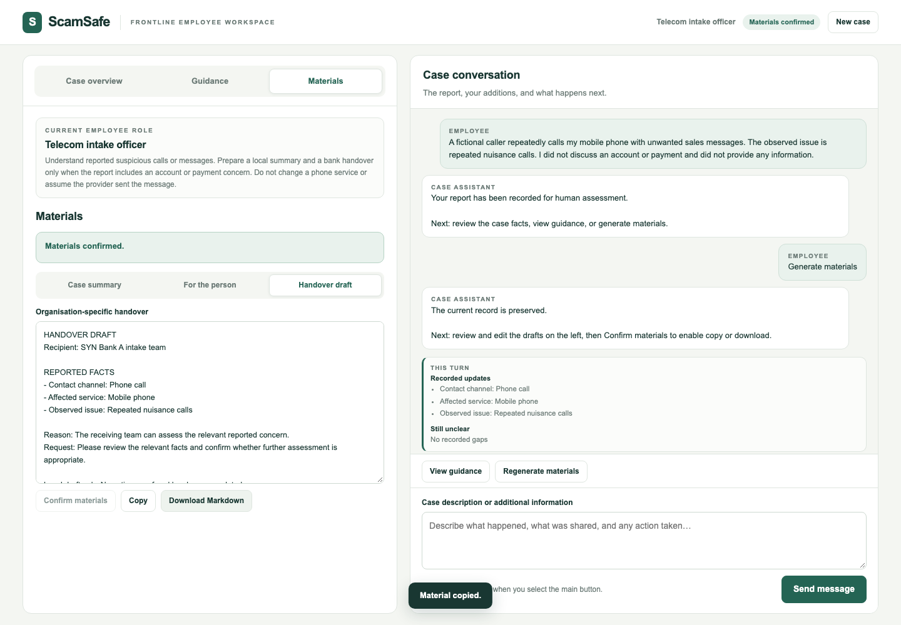
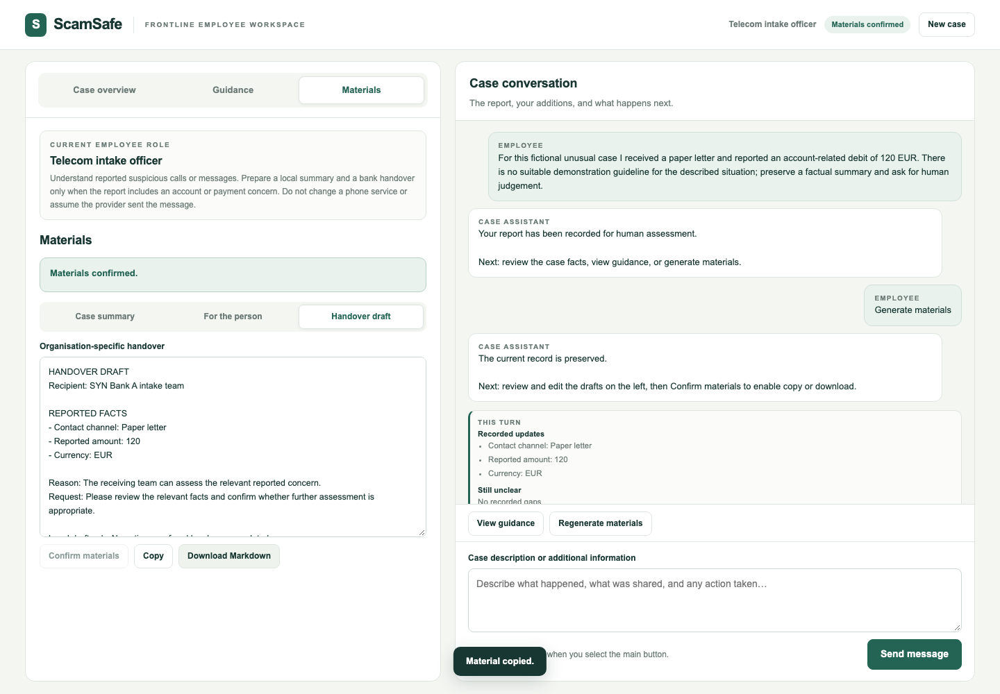

# ScamSafe full rebuild 完整测试记录

记录日期：2026-11-10  |  批次：F01 run-01

## 测试结论与版本信息

本轮已对 ScamSafe full rebuild 的银行和电信两个角色执行实际浏览器及 HTTP 测试。主流程中的查询、更正、材料编辑保护、复制和 Markdown 下载可在本次假模型条件下运行。电信交接边界发现一个明确缺陷，另有一个需要A确认的无引用交接降级问题，因此本轮不能判定双角色边界全部通过。

| 记录项目 | 实际值 |
| --- | --- |
| 记录编号 | F01 FULL REBUILD 20261110 RUN01 |
| 测试日期 | 2026年11月10日  Australia/Sydney |
| 来源分支 | origin/refactor/full-rebuild |
| 被测提交 | 26e7d78aab97f98832b7b7b3040c91e87046c3e9 |
| 测试分支 | codex/full-rebuild-validation |
| 执行方式 | Codex自动化执行并查看截图；人类观察与签字未记录 |
| 环境 | macOS 15.7.3 arm64   /   Node v24.22.1   /   Chromium 156.0.8078.4 |
| 应用入口 | /?view=course  临时本机回环服务 |
| 文档用途 | 交给A及模块负责人复现问题和安排修复；不是正式F人工验收 |

### 本轮检查汇总

| 检查层级 | 实际结果 | 说明 |
| --- | --- | --- |
| 仓库测试 | 180通过  2跳过  0失败 | 182项；跳过的是旧C和E可选浏览器用例 |
| 课程页原脚本 | 17组通过 | 注入courseTurn runner；复制内容已比较 |
| 新增双角色套件 | 170通过  2失败 | 6个新案例，每例分别跑银行和电信，共172检查点 |
| 最小边界复现 | 8通过  2失败 | 10项；两个失败重复同两项异常 |
| 构建与资料检查 | 通过 | build、check:business、仓库文档及差异格式检查 |

各层级的统计单位不同，不合并计算总通过率。应用测试在前一轮已实际执行；本次是在原始证据基础上编制完整记录，没有新增应用复测。

真实模型未执行。本机有效配置为mock，未配置模型地址、模型名称和密钥，也没有已保存设置或.env。用户已授权使用现成配置，但缺少可用配置。外部模型请求为0。

## 测试依据与覆盖范围

本轮以当前分支的新版PRD、COURSE_WORKBENCH_GUIDE及data/course/guidelines.json中的DEMO-G01至DEMO-G04为判断依据。原STATUS、旧T09单岗位和旧EX指引测试仍保留，但不代替新课程页的双角色验收。

### 执行方法

现有课程页脚本通过注入courseTurn runner检查页面接线。新增套件通过createApp的fetchImpl注入假提供商，继续执行真实runCourseTurn、OpenAI兼容请求构造、响应校验、状态合并、Chromium页面以及浏览器下载。新增套件并未绕过服务端状态合并。

新增页面套件38次假提供商调用，最小复现8次，合计46次；现有注入runner脚本另计，不属于提供商调用。这些结果可证明给定响应下的程序行为，不能证明模型会正确理解自由叙述或生成适当建议。

| 需求 | 检查对象 | 本轮覆盖及限制 |
| --- | --- | --- |
| FR01 | 两个角色及职责 | 银行和电信各6条页面流程；角色建议质量待真实模型验证 |
| FR02 | 输入与实际AI | 输入和HTTP链路通过；实际外部模型未执行 |
| FR03 | 结构化事实 | 给定提案的字段、Unknown、更正和人工编辑同步通过 |
| FR04 | 类型和关注线索 | 类型及压力线索传递通过；真实提取语义未验证 |
| FR05 | 数量和进度补问 | 查询不推进、多答案、unknown及第4题拒绝通过；按钮由原17组覆盖 |
| FR06 | 指引与建议 | 指引展示通过；跨机构边界见F01-001与F01-002 |
| FR07 | 输出材料 | 摘要和当事人说明可生成；银行交接存在错误生成边界 |
| FR08 | 编辑与确认 | 编辑撤销确认；事实变更保留人工正文并停止导出，通过 |
| FR09 | 复制与下载 | 所选材料页面、剪贴板、Markdown字节一致，通过 |
| FR10 | 失败与重试 | 502保留输入、复用失败消息ID；未配置503路径通过 |
| FR11 | 对话与事实同步 | 查询、更正、不确定、多答案和旧值保护通过 |
| FR12 | 下一步提示 | 本次响应含Next；真实模型回应的相关性与质量未验证 |

本轮未开展登录、真实权限系统、审计、持久化恢复、PDF、部署、多电脑及性能负载测试。这些能力不属于新版课程原型范围或本轮专项检查。

## 新案例输入与双角色结果 N01 N02

以下六份新叙述均为虚构输入。每份分别在全新银行和电信页面上下文执行，避免案件间串用事实。结构化响应由假提供商按测试数据给定。

### N01 供应商邮件与待处理付款

输入原文

> A fictional supplier emailed changed account details. I paid 4350 NZD and the transfer is pending. There was no text message or phone call. I kept the email.

检查条件  预期按Email渠道处理4350 NZD、Pending和邮件证据；没有短信或电话线索，银行角色不生成电信交接。

实际结果  银行无交接；电信生成银行交接。两个角色的材料确认、复制、下载和新案操作均通过。

提案字段  contactChannel=Email；claimedIdentity=A fictional supplier；amount=4350；currency=NZD；transactionStatus=Pending；evidenceAvailable=Email copy

证据索引  new-suite-attempt-01/N01-bank-record.json 与 N01-telecom-record.json；同名前缀PNG为对应页面截图。

### N02 跨机构短信及完整对话

输入原文

> A fictional SMS claimed to be SYN Bank A. I entered a banking password and saw an unfamiliar debit of 86 GBP. Its status is not known. I still have the message.

检查条件  初始金额86 GBP、交易状态Unknown；建立Q1至Q3。银行角色本机构建议引用DEMO-G01，电信角色引用DEMO-G02。

实际结果  银行生成电信交接；电信生成银行交接。两个角色都执行了查询、改19、表不确定、多答案、失败重试及人工改23。详细步骤见后文。

提案字段  contactChannel=SMS；claimedIdentity=SYN Bank A；sharedInformation=Banking password；amount=86；currency=GBP；transactionStatus=Unknown；evidenceAvailable=Message on phone

证据索引  new-suite-attempt-01/N02-bank-record.json 与 N02-telecom-record.json；同名前缀PNG为对应页面截图。

## 新案例输入与双角色结果 N03 N04

以下六份新叙述均为虚构输入。每份分别在全新银行和电信页面上下文执行，避免案件间串用事实。结构化响应由假提供商按测试数据给定。

### N03 纯电信骚扰电话

输入原文

> A fictional caller repeatedly calls my mobile phone with unwanted sales messages. The observed issue is repeated nuisance calls. I did not discuss an account or payment and did not provide any information.

检查条件  只提供Phone call、Mobile phone、Repeated nuisance calls；没有银行、金额、账户或凭证事实。本机构电信建议引用DEMO-G02。

实际结果  银行角色生成电信相关交接，符合本次预期。电信角色错误生成银行交接，并允许确认、复制、下载，见F01-001。

提案字段  contactChannel=Phone call；affectedService=Mobile phone；observedIssue=Repeated nuisance calls

证据索引  new-suite-attempt-01/N03-bank-record.json 与 N03-telecom-record.json；同名前缀PNG为对应页面截图。

### N04 压力线索和信息不足

输入原文

> I feel overwhelmed and under pressure after repeated calls telling me to act immediately. I cannot yet describe what they wanted. This is a fictional support report.

检查条件  类型为Insufficient information；记录overwhelmed及act immediately线索，引用DEMO-G03，不生成机构交接。

实际结果  两个角色均未生成交接；支持线索、当事人说明及导出流程通过。

提案字段  contactChannel=Phone calls；vulnerabilityCue=Feeling overwhelmed；urgencyCue=Pressure to act immediately

证据索引  new-suite-attempt-01/N04-bank-record.json 与 N04-telecom-record.json；同名前缀PNG为对应页面截图。

## 新案例输入与双角色结果 N05 N06

以下六份新叙述均为虚构输入。每份分别在全新银行和电信页面上下文执行，避免案件间串用事实。结构化响应由假提供商按测试数据给定。

### N05 中文跨机构叙述

输入原文

> 这是虚构测试：我收到冒充SYN Bank A的短信，输入了银行密码。后来发现246 CNY的陌生扣款，状态不确定。我保留了短信，没有联系银行。

检查条件  假提供商给出SMS、SYN Bank A、Banking password、246 CNY、Unknown交易状态及保留短信。

实际结果  银行生成电信交接；电信生成银行交接。中文文本和结构化结果可传递与显示。本例不代表真实模型的中文理解通过。

提案字段  contactChannel=SMS；claimedIdentity=SYN Bank A；sharedInformation=Banking password；amount=246；currency=CNY；transactionStatus=Unknown；evidenceAvailable=SMS retained

证据索引  new-suite-attempt-01/N05-bank-record.json 与 N05-telecom-record.json；同名前缀PNG为对应页面截图。

### N06 空建议和无交接引用的负向响应

输入原文

> For this fictional unusual case I received a paper letter and reported an account-related debit of 120 EUR. There is no suitable demonstration guideline for the described situation; preserve a factual summary and ask for human judgement.

检查条件  这是负向提供商响应测试：保留120 EUR账户担忧，但返回Other、空建议与空交接引用。保守预期是不要补无依据交接。

实际结果  银行无交接；电信仍生成银行稿。最小复现把handoverReason、handoverRequest、handoverGuidelineId都置null后仍出现，见F01-002。账户担忧本身可能适用DEMO-G01，本例不证明该指引实际不适用。

提案字段  contactChannel=Paper letter；amount=120；currency=EUR

证据索引  new-suite-attempt-01/N06-bank-record.json 与 N06-telecom-record.json；同名前缀PNG为对应页面截图。

## 关键操作的逐步测试记录

下列操作在N02银行和电信两个角色中均实际执行并通过。全部172个检查点另列于附带的逐项检查清单，保留原始检查ID、角色、结果和证据位置。

| 序号 | 输入或操作 | 实际观察 两角色均通过 |
| --- | --- | --- |
| 1 | 选择角色并填写N02 | 选择角色后保留原文；开始后隐藏角色切换 |
| 2 | Analyze case | 显示86 GBP、Unknown状态和3个问题；回复包含Next |
| 3 | Is the amount 13 GBP? | 即使假响应带金额13和Q1答案，事实与题数仍不变 |
| 4 | The correct amount is 19 GBP, not 86. | 金额明确更正为19；不把旧86当作最新值 |
| 5 | I cannot confirm whether the amount is exact. | 保留19，并记录uncertainty |
| 6 | 1: No further contact; 2: Pending; 3: I do not know. | 题状态为answered、answered、unknown；交易状态Pending |
| 7 | The message was deleted. 首次返回无效JSON | HTTP502；textarea保留原文，出现Retry |
| 8 | Retry | 复用失败用户消息ID；该原文只有一条用户消息 |
| 9 | Guidance 再 Generate materials | 按当前角色生成摘要、当事人说明及适用交接 |
| 10 | Confirm materials 再逐份Copy和Download Markdown | 页面、剪贴板、下载文件文本完全一致 |
| 11 | 摘要追加Employee note | 回到draft，Copy及Download禁用 |
| 12 | Case overview直接把金额改为23 | 已有人工正文保留；Materials need updating；不能确认 |
| 13 | 取消Regenerate materials | 原人工正文不变，提供商调用数不增加 |
| 14 | 确认Regenerate materials | 新摘要采用员工值23，等待重新确认 |
| 15 | 取消New case 然后确认New case | 取消保留材料；确认后清空案件和输入 |

处理中还实际检查了输入框和New case按钮禁用，避免重复提交。无未捕获页面异常。unknown、Skip与End按钮的其他路径由现有课程页17组脚本验证，不能记作本轮新套件额外的自由文本模型理解能力。

下载文件名分别为scamsafe-summary.md、scamsafe-person.md、scamsafe-handover.md。只有实际出现交接页签时才下载交接稿；错误生成的交接稿也如实留存作为失败证据。

## F01 001 电信骚扰被判为银行问题

级别 P1  明确缺陷。纯电信骚扰问题被错误分配给银行，且错误稿可被确认和导出，阻断本轮电信机构边界验收。

判断依据为PRD FR01、FR06、FR07及5.3，DEMO-G02与电信角色职责均要求报告确有账户或付款担忧才向银行交接。N03只提供电话、移动服务和重复骚扰问题。

### 最短复现与实际结果

选择Telecom employee，输入N03并分析，再点击Generate materials。预期只有摘要及当事人说明；实际出现Handover draft，收件人为SYN Bank A intake team。随后Confirm materials、Copy和Markdown下载均可成功。

独立HTTP复现把模型三个交接字段全部置null，程序仍生成同一银行稿。定位到shared/course-case.ts中BANK_CLUE_KEYS包含通用observedIssue，handoverRecipient仅检查字段known，就将非银行异常当作银行线索。



证据  N03-telecom.png、N03-telecom-record.json、N03-telecom-scamsafe-handover.md，以及boundary-replay-result.json中的N03-telecom-null-handover。建议A协调公共交接资格修复，本轮未修改实现。

## F01 002 空引用响应仍生成交接稿

级别 P2  稳健性问题 待A确认。模型没有提供建议和交接依据时，模板仍自行补出可以确认导出的机构稿。

N06电信角色保留120 EUR账户担忧，假提供商返回recommendations为空数组；最小复现还令handoverReason、handoverRequest和handoverGuidelineId全部为null。

### 实际观察和判断边界

HTTP返回200并生成Recipient为SYN Bank A intake team的交接稿，Reason使用程序通用文案，正文没有Basis。预期保守分支不在缺少交接内容和引用时补齐机构路径。

账户担忧本身可能适用DEMO-G01。不能根据叙述中的“无合适指引”证明该指引实际不适用，也不能把本例称作真实模型已生成错误建议。本项需要A确认：是否允许这种默认降级，以及允许时必须显示哪些事实和指引依据。



证据  N06-telecom-record.json、N06-telecom.png、N06-telecom-scamsafe-handover.md及boundary-replay-result.json。定位到handoverRecipient未检查当前交接依据，composeHandover在收件人存在时补默认理由。

## HTTP边界复现与未执行项目

以下10项通过独立临时服务调用真实POST /api/course/turn和runCourseTurn。假提供商仅返回预定JSON；服务器错误响应及合并行为为实际执行结果。

| 序号 | 检查内容 | HTTP | 结果 |
| --- | --- | --- | --- |
| 1 | 纯骚扰电话且交接三字段null时，不应生成银行稿 | 200 | 失败 |
| 2 | 空建议且交接三字段null时，不应补无依据银行稿 | 200 | 失败 |
| 3 | 银行 旧模型86不能覆盖人工23 | 200 | 通过 |
| 4 | 银行 未确认替换在调用提供商前拒绝 | 409 | 通过 |
| 5 | 银行 虚构来源拒绝整个提案 | 502 | 通过 |
| 6 | 银行 第四个问题超出契约 | 502 | 通过 |
| 7 | 电信 旧模型86不能覆盖人工23 | 200 | 通过 |
| 8 | 电信 未确认替换在调用提供商前拒绝 | 409 | 通过 |
| 9 | 电信 虚构来源拒绝整个提案 | 502 | 通过 |
| 10 | 电信 第四个问题超出契约 | 502 | 通过 |

两个失败是前述交接异常的重复证据，不是新增两个缺陷。旧金额保护、未确认替换、伪造来源和第四问题四类边界在两个角色中均通过。

### 未执行和范围限制

| 项目 | 状态与原因 |
| --- | --- |
| 真实模型的银行和电信案例 | 未执行。本机mock且没有可用模型配置，外部请求0。 |
| 真实中文理解与建议质量 | 未执行。N05仅证明中文输入及给定结果可传递和显示。 |
| 旧C与E可选浏览器用例 | 默认跳过2项；182项的通过数不含它们。 |
| 正式人类F验收及修复后复测 | 未执行。Codex执行和截图观察不能代替人类签字或F02。 |
| PDF 持久化 多案件 生产部署 | 不属于新版课程原型范围；本轮没有扩大检查范围。 |
| 测试总耗时及人工起止时间 | 未记录完整起止时间。单元包日志有duration_ms，不当作整轮耗时。 |

## 复测条件与证据交付

### 复现命令

以下命令在仓库根目录运行，要求Node 24及既有依赖。本轮实际npm通过内置Node与local/tools/npm/bin/npm-cli.js调用；复测使用新目录，保留现有失败结果。

```sh
npm run check
npm run build
npm run check:business
node --import tsx tests/course-browser.ts
node --import tsx evidence/task-results/F01/run-01/new-suite.ts \
  evidence/task-results/F01/run-02/new-suite
node --import tsx evidence/task-results/F01/run-01/boundary-replay.ts \
  evidence/task-results/F01/run-02-boundary.json
```

原始新套件命令使用new-suite-attempt-01；上面的run-02示例留给后续复测。new-suite和boundary-replay均拒绝覆盖已存在结果。未修复时，两个脚本的exit=1应被保留。

### 修复后应确认的结果

A确认交接资格及空引用降级规则后，按原输入、相同假提案分别复测银行和电信。N03电信不再出现银行交接，摘要与当事人说明仍可用；N02与N05的正确跨机构交接不受影响。N06按明确后的规则验证，不为得到通过而默默删除失败预期。

本机配置可用真实模型后，至少分别完成一个银行和一个电信案例，检查实际提取、补问数量、查询与更正区别、指引及交接适用性、材料反映最新事实；中文质量另行记录。不要把现成假模型结果改标为真实模型通过。

### 证据位置

| 文件或目录 | 内容 |
| --- | --- |
| baseline.json | 基线 环境 脚本SHA256 |
| check.txt build.txt business.txt | 仓库测试 构建 旧批准包检查原始日志 |
| course-browser.txt | 原课程页17组浏览器结果 |
| new-cases.json new-suite.ts | 6份新叙述及双角色页面测试脚本 |
| new-suite-attempt-01/result.json | 172个逐项结果 含失败预期与实际 |
| new-suite-attempt-01/requests.json | 本批合成请求及响应 |
| new-suite-attempt-01/ | 12张角色截图 合成案件快照及Markdown下载物 |
| boundary-replay.ts 与结果JSON | 最小边界脚本 10项结果及失败HTTP正文 |
| record/逐项检查清单.md | 172个检查点及10个边界结果的完整可读清单 |

以上路径均相对于evidence/task-results/F01/run-01。本轮唯一动态记录为docs/project/tasks/F01.md。当前仅编制报告和检查证据，未修改业务实现、未提交推送本次测试，也未宣布A接收或正式验收通过。

## 完整检查清单

[逐项检查清单](逐项检查清单.md)包含全部172个主套件检查点和10项最小复现，保留原始ID及实际结果。
