# Targeting scams: Report of the National Anti-Scam Centre on scams data and activity 2025

Published: March 2026. Converted: 2026-10-12.
[ACCC source publication](https://www.accc.gov.au/about-us/publications/serial-publications/targeting-scams-reports-on-scams-activity/targeting-scams-report-of-the-national-anti-scam-centre-on-scams-data-and-activity-2025)

Original PDF removed from this project at the user's request on 2026-10-13; the converted text and page images are retained.

> 转换说明：保留原文语言与 49 个 PDF 页码标记。正文转换为 Markdown；表格使用等宽文本保留列位置，避免合并单元格导致字段错配。图表、信息图、图片内文字和复杂版式请展开各页原图核对。PDF 页码包含封面，与报告印刷页码不同。

<!-- page 1 -->
## PDF page 1

### Targeting scams

### Report of the National Anti-Scam Centre

### on scams data and activity 2025

March 2026

<details>
<summary>PDF page 1: original layout / charts</summary>

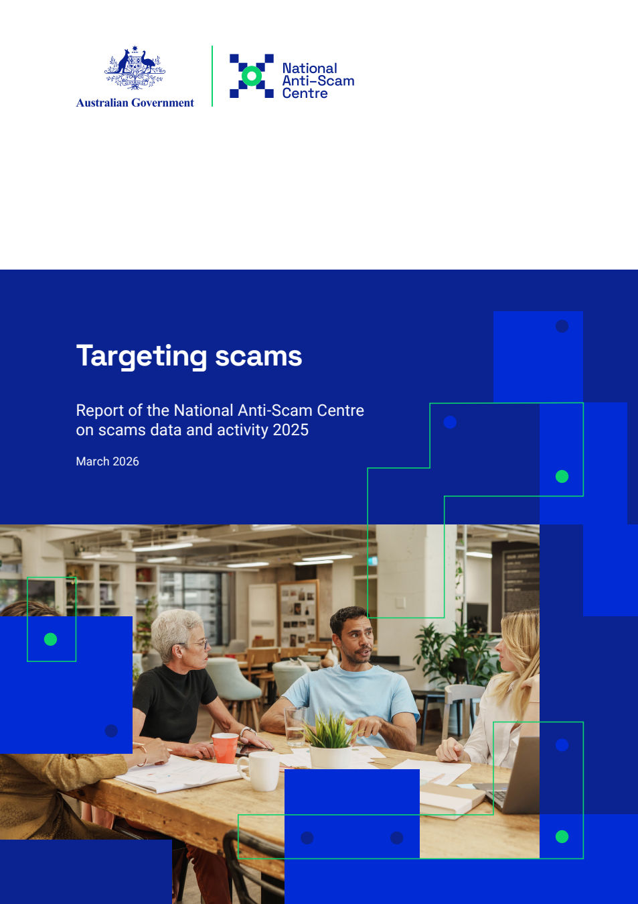

</details>

<!-- page 2 -->
## PDF page 2

Acknowledgment of country

The ACCC acknowledges the traditional owners and custodians of Country throughout
Australia and recognises their continuing connection to the land, sea and community. We pay
our respects to them and their cultures; and to their Elders past, present and future.

Australian Competition and Consumer Commission
Land of the Ngunnawal people
23 Marcus Clarke Street, Canberra, Australian Capital Territory, 2601
© Commonwealth of Australia 2026
This work is copyright. In addition to any use permitted under the Copyright Act 1968, all material contained within this work is provided under a
Creative Commons Attribution 4.0 Australia licence, with the exception of:

ƒ the Commonwealth Coat of Arms

ƒ the ACCC, AER, NASC and SCAMWATCH logos

ƒ any illustration, diagram, photograph or graphic over which the Australian Competition and Consumer Commission does not hold copyright, but
which may be part of or contained within this publication.
The details of the relevant licence conditions are available on the Creative Commons website, as is the full legal code for the CC BY 4.0 AU licence.
Requests and inquiries concerning reproduction and rights should be addressed to the Director, Corporate Communications, ACCC, GPO Box 3131,
Canberra ACT 2601.
Important notice
The information in this publication is for general guidance only. It does not constitute legal or other professional advice, and should not be relied
on as a statement of the law in any jurisdiction. Because it is intended only as a general guide, it may contain generalisations. You should obtain
professional advice if you have any specific concern.
The ACCC has made every reasonable effort to provide current and accurate information, but it does not make any guarantees regarding the
accuracy, currency or completeness of that information.
Parties who wish to re-publish or otherwise use the information in this publication must check this information for currency and accuracy prior to
publication. This should be done prior to each publication edition, as ACCC guidance and relevant transitional legislation frequently change. Any
queries parties have should be addressed to the General Manager, Strategic Communications, ACCC, GPO Box 3131, Canberra ACT 2601.
ACCC 03/26_26–02
www.accc.gov.au

### Links on this page

- [http://www.accc.gov.au](http://www.accc.gov.au)

<details>
<summary>PDF page 2: original layout / charts</summary>

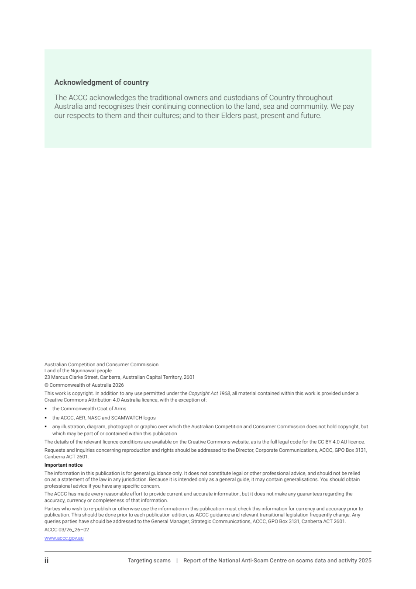

</details>

<!-- page 3 -->
## PDF page 3

### Contents

Foreword 1

At a glance 3

Key statistics 4

National Anti-Scam Centre in action 6

Disruption 6

Consumer awareness 20

Victim support 27

Looking forward 29

Appendix 1 – Scamwatch data and observations 30

Report and loss statistics 30

People and communities at increased risk of harm from scams 37

Appendix 2 – About the data used in this report 42

Scamwatch data 42

Australian Signals Directorate – ReportCyber 43

IDCARE – Identity theft and cyber support service 43

Australian Securities and Investments Commission (ASIC) 44

Financial sector data 44

Comparison with data outcomes in the Targeting Scams Report 2024 44

Unreported losses 45

<details>
<summary>PDF page 3: original layout / charts</summary>

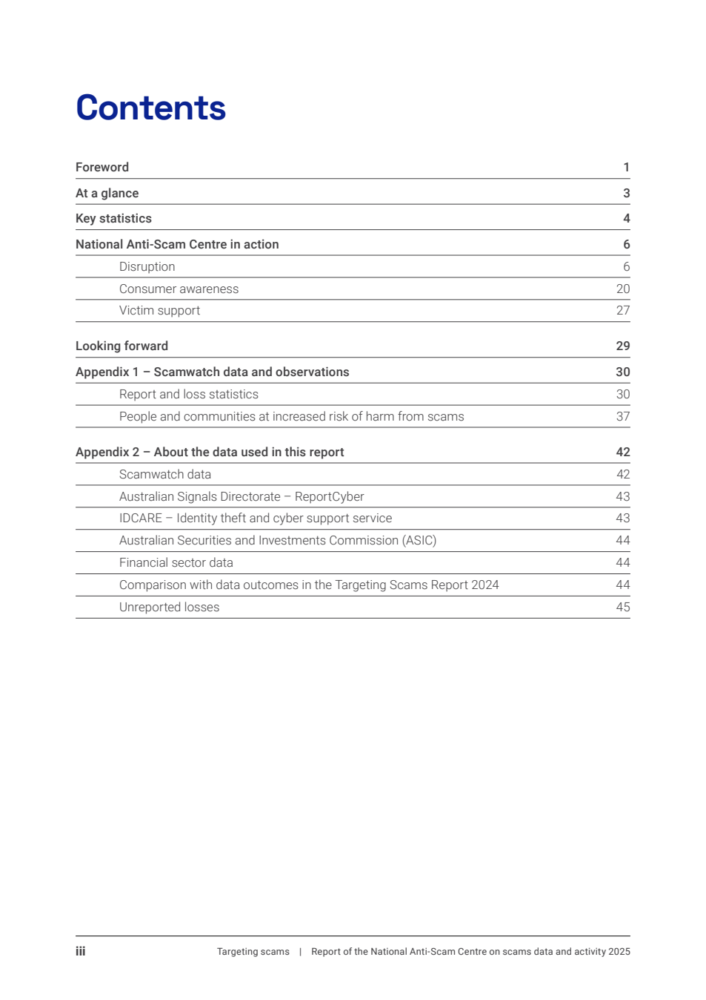

</details>

<!-- page 4 -->
## PDF page 4

### Foreword

This report provides insight into the scams targeting Australians in 2025 and highlights the impact of
combined efforts by government, law enforcement, community sector, and industry to combat these
financial crimes. This is the third Targeting Scams Report produced by the National Anti-Scam Centre
since its establishment on 1 July 2023.

Data from Scamwatch, ReportCyber, the Australian Financial Crimes Exchange (AFCX), IDCARE and
the Australian Securities and Investments Commission (ASIC) shows Australians reported losses
totalling $2.18 billion in 2025, an increase of 7.8% from 2024. Over the same period, report volumes
remained relatively steady with 481,523 scam reports compared to 494,732 in 2024.

Through Scamwatch data we are able to observe trends such as emerging or surging scam types or
groups particularly impacted. A fall in the median loss from $500 in 2024 to $400 in 2025 indicates
that on average more people are successfully targeted by criminals, but the amounts lost are lower.
Our most vulnerable Australians are still disproportionately impacted by scams with First Nations
and culturally and linguistically diverse communities both reporting a higher median loss. Older
Australians, who according to the Australian Bureau of Statistics make up approximately 17.1% of the
population, account for 26.5% of overall losses reported to Scamwatch.

These outcomes underline the importance of continued action and vigilance across the 3 pillars of
the National Anti-Scam Centre’s work – prevention and disruption, community awareness and victim
support. We have slowed the growth in losses, but more connected action is required to stop these
motivated and sophisticated criminals.

The passing of the Scams Prevention Framework Act (Cth) in February 2025 was a decisive step
towards strengthening weak links in the scam prevention ecosystem. The framework creates
overarching principles that will apply to designated sectors, ensuring a consistent approach to
tackling scams in Australia. The banking, telecommunications, and digital platform sectors are
expected to be designated shortly.

Fusion Cells demonstrate the intelligence and disruption value of combining data (and expertise) held
across the ecosystem. The Scams Prevention Framework provides for enhanced intelligence sharing
at scale. Enhanced information sharing, supported by the National Anti-Scam Centre’s significant
technology build, will enable the high-frequency, secure data sharing required by the Framework.

The National Anti-Scam Centre and the Scams Prevention Framework positions Australia as a global
leader and inspires others to see the value of collaboration, information sharing and enforceable
binding obligations. Scammers run criminal networks that move money, data, and even human
resources across the globe. International collaboration, such as our recent membership of the Global
Anti-Scam Alliance advisory board, helps create a unified global response that makes it harder for
scammers to find safe havens.

<details>
<summary>PDF page 4: original layout / charts</summary>

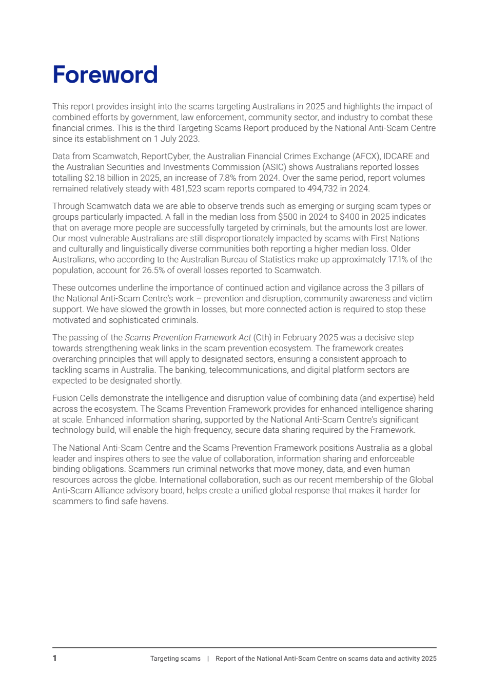

</details>

<!-- page 5 -->
## PDF page 5

This year’s report also highlights the voluntary efforts of stakeholders to enhance consumer
education, share real time warnings, and collaborate to identify and disrupt emerging threats.
However, criminals constantly adapt their tactics so that interventions that work today may be
ineffective tomorrow. Through continued innovation, vigilance, and cooperation we can prevent
harm; protect individuals from the emotional distress that scams cause and increase trust in the
digital economy.

Scams are often described as a ‘wicked problem’ because they are complex, fast-evolving, and
resistant to simple solutions. This report demonstrates the collaboration and shared accountability
necessary to tackle the harm caused by scams. We extend our sincere thanks to the many individuals
and organisations who have shown unwavering commitment, cooperation and resolve in the fight
against scams.

Catriona Lowe
Deputy Chair, ACCC

<details>
<summary>PDF page 5: original layout / charts</summary>

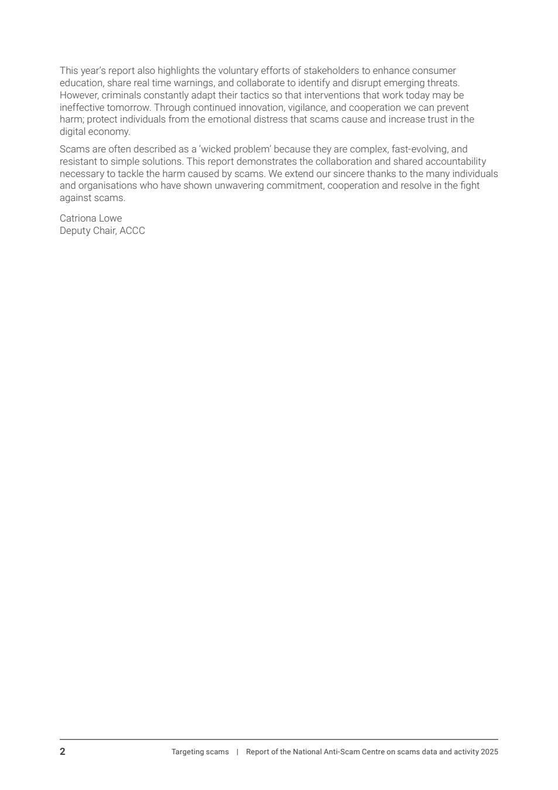

</details>

<!-- page 6 -->
## PDF page 6

### At a glance

### Losses

### $2.18 billion lost 7.8%

### 481,523

Total combined losses reported to Scamwatch,

### scam reports

ReportCyber, IDCARE, the Australian Financial Crimes

### Exchange (AFCX), and the Australian Securities and 2.7%

Investment Commission (ASIC).

### Combined losses over last 5 years

2022
$3.1b
2023
$2.7b

2025
2024 $2.2b
2021 $2.0b
$1.8b

### Top 5 scam types by loss 2025 (combined data)

Investment Payment redirection Romance Phishing Remote access

### $837.7m $166.8m $139.9m $97.6m $69.9m

The losses from the Top 5 scam types accounted for 60% of total losses in 2025.

### Top 5 scam types by loss 2024 (combined data)

Investment Romance Payment redirection Remote access Phishing

### $945.0m $156.8m $152.6m $106.0m $84.5m

The losses from the Top 5 scam types accounted for 71% of total losses in 2024.

<details>
<summary>PDF page 6: original layout / charts</summary>

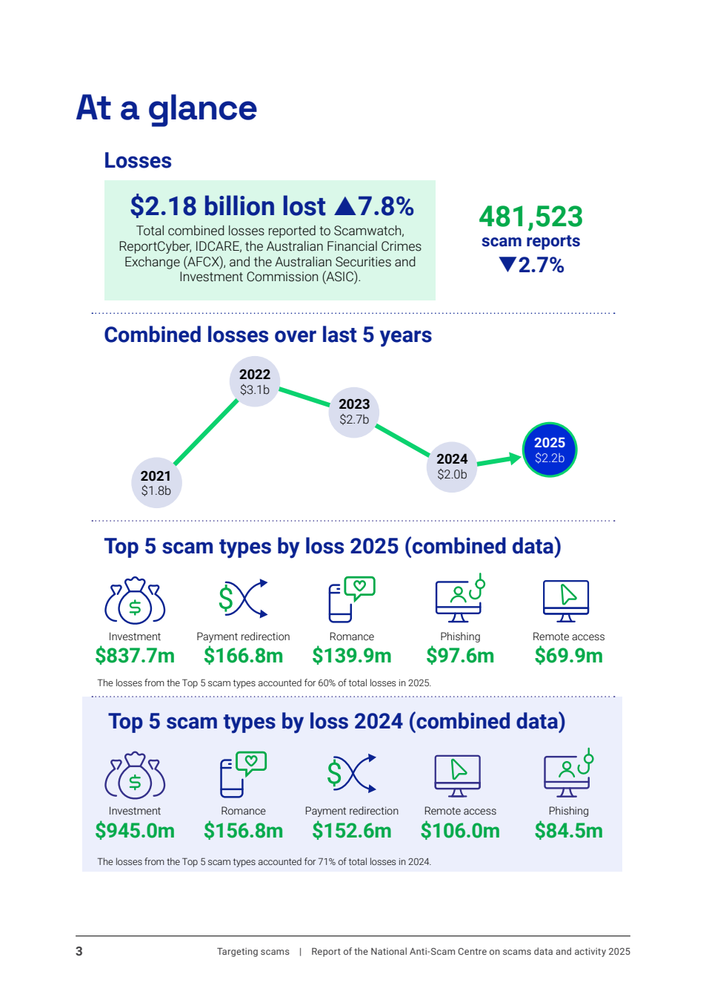

</details>

<!-- page 7 -->
## PDF page 7

### Key statistics

Australians can report scams to a range of sources. The National Anti-Scam Centre continues its
work to bring together these data sources to provide a more complete picture of the level of scam
activity in Australia.

This report incorporates data from Scamwatch, ReportCyber, the Australian Financial Crimes
Exchange (AFCX), IDCARE, and the Australian Securities and Investments Commission (ASIC). More
detailed analysis about Scamwatch data is contained in Appendix 1. Further information about the
data sources and adjustments is contained in Appendix 2.

In 2025, Australians made a combined total of 481,523 reports across these institutions remaining
relatively consistent with 2024 volumes. Of these 274,577 reported financial losses of over
$2.18 billion (a slight increase of 7.8%). This compares with a combined total of 494,732 reports and
combined reported losses of over $2.03 billion in 2024. There has been an 11.2% increase in reports
with a loss from 2024.

Table 1 and Table 2 highlight variance in reporting across the data sets. This variance is in part a
reflection of where scam victims are more likely to report, depending on the circumstances. For
example, victims may be more likely to report high-loss cyber related scams to ReportCyber, financial
loss incurred through bank transfers to a bank (appearing in the AFCX data), and more altruistic
reporters without financial loss may report to Scamwatch. Bringing these data sets together provides
a more complete picture of the scams landscape. Reports without loss hold intelligence value as they
inform early disruption activities, and add to understanding of scam methodology, thereby reducing
the likelihood of others falling victim to the scam.

Table 1: Combined losses and reports 2024 and 2025

```text
                                                               % change in loss
                            2024                 2025              from 2024
          Organisation Number of Reports Losses Number of Reports Losses %
          Scamwatch       249,448 $318.8m      200,675  $334.8m      5.0% p

          ReportCyber      64,682 $734.2m       58,876  $774.2m      5.4% p
          AFCX1            169,184 $812.3m     202,943  $842.3m      3.7% p

          ASIC2              965   $93.4m       1,565   $135.0m     44.5% p
          IDCARE           42,193 $513.6m       47,589  $535.8m      4.3% p

          Adjustments3     -31,740 -$445.6m     -30,125 -$438.1 m
          TOTAL           494,732   $2.0b      481,523   $2.18b      7.8% p
```

1 Caution should be exercised in comparing AFCX results for 2024 and 2025. During 2025, the AFCX stopped providing
information about which bank members reports and losses are included with the data. See Appendix 2 for further
information about methodology.
2 The increased loss reported by ASIC may be attributed to the introduction of a simplified online reporting process and a
high-volume case impacting a group of overseas victims who lodged individual reports about the same entity and conduct.
The loss amounts reported by individual victims are not verified.
3 There is some duplication in the data sets. Where the same scam is reported by a consumer multiple times or to multiple
organisations, adjustments are made to remove duplication to the extent possible (see Appendix 2 for further information
on adjustments).

<details>
<summary>PDF page 7: original layout / charts</summary>

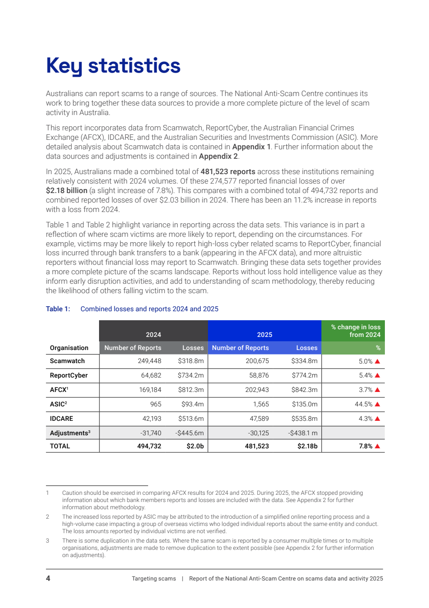

</details>

<!-- page 8 -->
## PDF page 8

Table 2: Combined reports with and without loss 2024 compared with 2025

```text
                                2024                      2025
                              Reports % of Reports        Reports % of Reports
          Organisation Reports with loss with loss Reports with loss with loss
          Scamwatch    249,448 22,408      9.0%   200,675  28,202    14.1%

          ReportCyber  64,682  34,562     53.4%   58,876   30,876    52.4%
          AFCX         169,184 163,8604   96.8%   202,943 199,666    98.4%

          ASIC           965     N/A       N/A     1,565    N/A5      N/A
          IDCARE        42,193 13,916     33.0%    47,589  15,833    33.3%
```

While investment scams continue to result in the most significant financial harm to Australians
with combined losses of $837.7 million in 2025, financial losses decreased for investment scams;
romance scams and remote access scams as outlined in Table 3 below. Many Australians have
their retirement savings or superannuation stolen through Investment scams and Romance scams
contributing to higher overall losses in these categories.

Table 3: Combined losses by category 20256

```text
                                                                  %
                                                               change
         Scam             Report                           Total from Total
         category Scamwatch Cyber AFCX ASIC IDCARE Adjustments7 20258 2024 2024
         Investment $172.2m $357.8m $190.9m $64.0m $284.0m $231.1m $837.7m -11.4%q $945.0m
         Payment
                    $12.2m $114.7m $41.1m N/A $11.6m $12.8m $166.8m 9.3%p $152.6m
         redirection
         Romance    $28.7m $44.9m $50.9m N/A $68.7m $53.3m $139.9m -10.8%q $156.8m

         Phishing   $31.1m  N/A $47.4m N/A $102.3m $83.2m $97.6m 15.5%p $84.5m
         Remote
                    $4.8m   N/A $64.3m N/A $4.4m    $3.6m $69.9m -34.1%q $106.0m
         access
         Other9    $85.9m $256.8m $447.6m $71.0m $64.9m $54.1m $872.1m 49.8%p $582.3m
```

4 The 2024 Report contained an error in the number of AFCX reports with loss when it referred to 136,719 (80.8%) reports with
loss. The error was caused by the filtering of data in a spreadsheet where the rows were exceeded. It was not detected by
the ACCC or the AFCX at the time.
5 In 2024 and 2025 ASIC data was provided in aggregate form, consequently, reports with loss are not available.
6 Variations across organisations reflect differences in reporting pathways, data coverage, jurisdiction and the possibility that
a single scam case may be reported to more than one organisation. To address potential overlaps, a de-duplication process
is applied across datasets. Identified overlaps are reflected through an adjustment line item to ensure totals represent
unique cases while maintaining transparency. See Appendix 2 for further information about methodology.
7 Totals adjusted for potential duplication of reporting, see Appendix 2 for further information.
8 Totals for each organisation may differ slightly from totals in Table 1 due to rounding of scam types in Table 3.
9 ‘Other’ includes all other scams which are not part of the top 5 scams causing the highest losses.

<details>
<summary>PDF page 8: original layout / charts</summary>

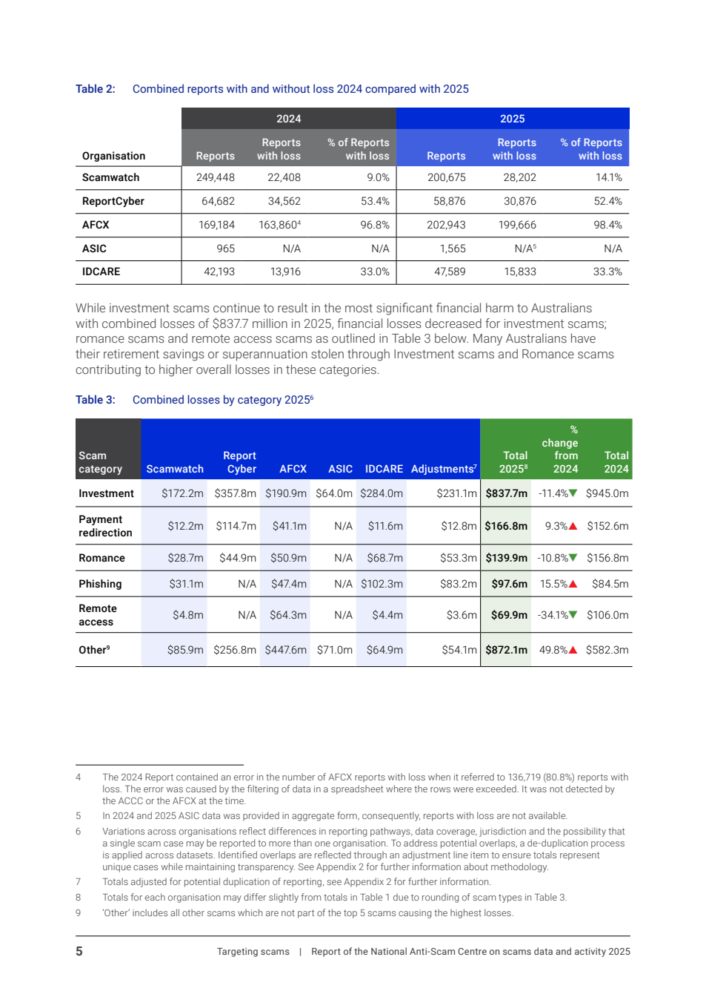

</details>

<!-- page 9 -->
## PDF page 9

### National Anti-Scam Centre in

### action

This section of the report focuses on key initiatives that have protected Australians and reduced the
harm caused by scams.

### Disruption

The National Anti-Scam Centre and partners’ disruption activity focuses on preventing contact
between the criminals who perpetrate scams and their victims, breaking contact where it has already
occurred, and preventing transfer of money or personal information.

In 2025 the National Anti-Scam Centre:

ƒ sent over 8,400 websites for assessment, resulting in the removal of over 7,500 scam URLs – an
increase of at least 30% compared to 2024

ƒ referred over 7,000 suspected Facebook scam URLs to Meta for further investigation

ƒ referred 844 Gmail addresses, 14 organic YouTube URLs and 2,098 advertisements to Google for
further investigation

ƒ referred 19 Telegram channels for further investigation

ƒ referred 4,246 unique phone numbers and 921 unique sender IDs to telecommunications
partners for disruption, over 4 times as many as in 2024

ƒ referred hundreds of high-risk scam call back numbers to Optus,10 expanding its call blocking
disruption activity to include tech-support and payment impersonation scams

ƒ referred intelligence to our third-party takedown service, as well as Google and Meta, for removal,
resulting in the removal of over 600 Betting scam websites and over 600 social media profiles
and forums.

The telecommunications sector played an important role in protecting Australians from scams
in 2025. The National Anti-Scam Centre invited the Australian Communications and Media Authority
(ACMA) and peak industry body, the Australian Telecommunications Alliance (ATA) to highlight
significant anti-scam initiatives in 2025. Their contributions are set out below.

10 Scammers provide phone numbers for victims to call in a range of different scams via fake pop-up warnings, emails or
invoices. Impersonated brands currently involved in this initiative include Microsoft, PayPal, Afterpay, Binance and CoinSpot.

<details>
<summary>PDF page 9: original layout / charts</summary>

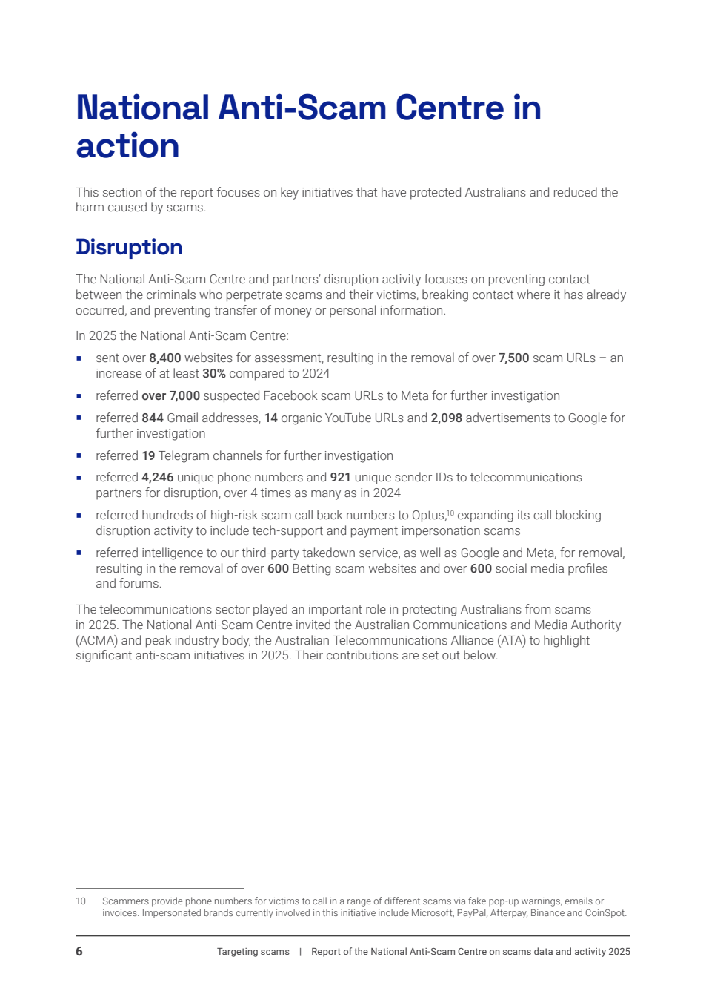

</details>

<!-- page 10 -->
## PDF page 10

### Anti-scam initiatives: The Australian Communications and Media

### Authority11

The Australian Communications and Media Authority (ACMA) is working to disrupt scammers
attempting to use telco networks to defraud Australians. In 2025, the ACMA focused on
enforcing anti-scam rules including mobile number fraud rules and the Reducing Scam Calls
and Scam SMs Industry Code (Scam Code),12 implementing new scam disruption initiatives,
educating consumers, and collaborating with key stakeholders domestically and internationally,
including the National Anti-Scam Centre.

In 2025, the ACMA finalised 3 investigations into telco compliance with the Scam Code
and gave 3 directions to telcos to comply with obligations.13 The ACMA also finalised 5
investigations into telco compliance with mobile number fraud rules resulting in 3 businesses
paying a total of over $4 million in penalties, with 2 further enforcement outcomes pending.14

The ACMA continues to engage with telcos to share intelligence on known scam and fraud
threats and has taken strong enforcement action where non-compliance is found, to ensure
that gaps in telco processes exploited by scammers are closed.

As part of the Government’s ‘Fighting Scams’ initiative, the ACMA is implementing a mandatory
SMS Sender ID Register.15 At the end of 2025, there were 71 alpha tags (branded sender IDs)
on the pilot Register, many of which scammers had previously tried to use in impersonation
scams. The mandatory register will launch on 1 July 2026.

Telcos reported blocking over 492.7 million scam calls and over 153.5 million scam SMS under
the obligations in the Scam Code from January to December 2025.

11 ACMA provided content for this information box.
12 ACMA, Telecommunications Service Provider (Customer Identity Authentication) Determination 2022, Federal Register
of Legislation, 2022, accessed 23 February 2026; ACMA, Telecommunications (Mobile Number Pre-Porting Additional
Identity Verification) Industry Standard 2020, Federal Register of Legislation, 2020, accessed 23 February 2026; ATA,
Industry Code C661:2022 Reducing Scam Calls and Scam SMs [PDF 376 KB], ATA, 2022, accessed 23 February 2026.
13 ACMA, VoiceHub breaches phone scam rules, ACMA, 30 May 2025, accessed 23 February 2026; ACMA,
TeleSign directed to comply with scam rules, ACMA, 29 August 2025, accessed 23 February 2026; ACMA,
Buroserv directed to comply with anti-scam rules, ACMA, 25 September 2025, accessed 23 February 2026.
14 ACMA, Circles.Life pays $413K for more anti-scam breaches [media release], ACMA, 22 May 2025, accessed
23 February 2026; ACMA, Exetel penalised $694K for anti-scam breaches [media release], ACMA, 27 August 2025, accessed
23 February 2026; ACMA, Optus penalised $826K for breaching anti-scam rules [media release], ACMA, 19 November 2025,
accessed 23 February 2026; ACMA, Southern Phone penalised $2.5M for anti-scam breaches [media release], ACMA,
03 December 2025, accessed 23 February 2026; ACMA, Lycamobile pays $376K in scam rule crackdown [media release],
ACMA, 4 February 2026, accessed 23 February 2026.
15 ACMA, SMS Sender ID Register, ACMA website, n.d., accessed 23 February 2026.

### Links on this page

- [https://www.legislation.gov.au/F2022L00548/latest/text](https://www.legislation.gov.au/F2022L00548/latest/text)
- [https://www.legislation.gov.au/F2020L00179/asmade/text](https://www.legislation.gov.au/F2020L00179/asmade/text)
- [https://www.austelco.org.au/wp-content/uploads/2025/06/C661_2022.pdf](https://www.austelco.org.au/wp-content/uploads/2025/06/C661_2022.pdf)
- [https://www.acma.gov.au/articles/2025-05/voicehub-breaches-phone-scam-rules](https://www.acma.gov.au/articles/2025-05/voicehub-breaches-phone-scam-rules)
- [https://www.acma.gov.au/articles/2025-08/telesign-directed-comply-scam-rules](https://www.acma.gov.au/articles/2025-08/telesign-directed-comply-scam-rules)
- [https://www.acma.gov.au/articles/2025-09/buroserv-directed-comply-anti-scam-rules](https://www.acma.gov.au/articles/2025-09/buroserv-directed-comply-anti-scam-rules)
- [https://www.acma.gov.au/articles/2025-05/circleslife-pays-413k-more-anti-scam-breaches](https://www.acma.gov.au/articles/2025-05/circleslife-pays-413k-more-anti-scam-breaches)
- [https://www.acma.gov.au/articles/2025-08/exetel-penalised-694k-anti-scam-breaches](https://www.acma.gov.au/articles/2025-08/exetel-penalised-694k-anti-scam-breaches)
- [https://www.acma.gov.au/articles/2025-11/optus-penalised-826k-breaching-anti-scam-rules](https://www.acma.gov.au/articles/2025-11/optus-penalised-826k-breaching-anti-scam-rules)
- [https://www.acma.gov.au/articles/2025-12/southern-phone-penalised-25m-anti-scam-breaches](https://www.acma.gov.au/articles/2025-12/southern-phone-penalised-25m-anti-scam-breaches)
- [https://www.acma.gov.au/articles/2026-02/lycamobile-pays-376k-scam-rule-crackdown](https://www.acma.gov.au/articles/2026-02/lycamobile-pays-376k-scam-rule-crackdown)
- [https://www.acma.gov.au/sms-sender-id-register](https://www.acma.gov.au/sms-sender-id-register)

<details>
<summary>PDF page 10: original layout / charts</summary>

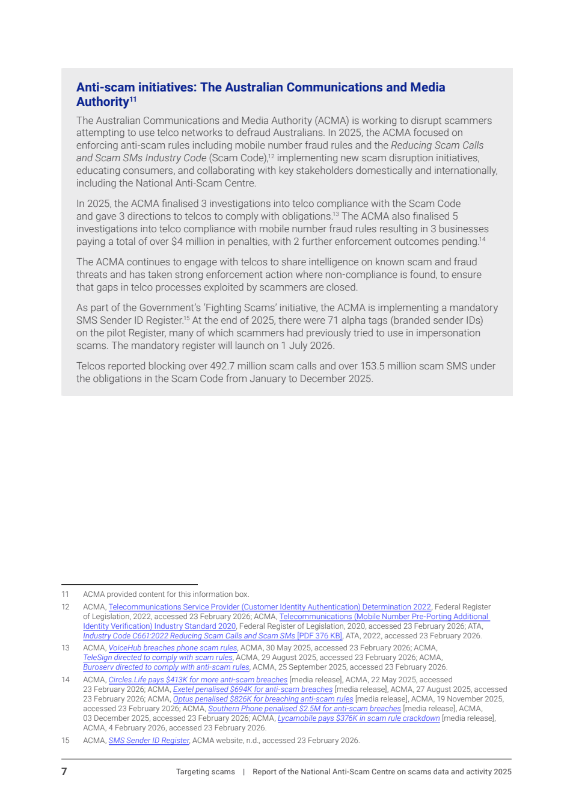

</details>

<!-- page 11 -->
## PDF page 11

### Examples of communications sector scam prevention initiatives:

### Australian Telecommunications Alliance16

Overall telcos report blocking more than 2.8 billion scam calls and almost 1 billion scam texts
since the Scam Code commenced in 2020.

Scam reports to Scamwatch where the contact method was listed as ‘phone call’ continue
to decline year-on-year from when the Scam Code was introduced, with reported numbers
for 2025 now being 73.7% below the 2021 level.17 Scam reports with ‘text message’ as the
contact method equally declined by 73.5% in the time from 2023 to 2025.18

Telcos are implementing processes for the new SMS Sender ID Register,19 which will
over-stamp (and eventually block) SMS scams originating from any unregistered SMS Sender
IDs, making it hard for scammers to impersonate well-known brands, such as toll road
operators, online shopping platforms, or banks.

TPG Telecom hosts the Security and Fraud Alliance Forum, a strategic initiative to support
cross-industry and stakeholder collaboration to combat scams, fraud, and emerging security
risks. The Forum meets at least 3 times per year. Participants include representatives
from telecommunications, banking, law enforcement, fraud and cyber security experts,
broadcasting, cryptocurrency, and regulators.

TPG Telecom is trialling a Proof of Concept with Apate.AI using chat bots to disrupt
impersonation scams by diverting scammers time and extracting important information from
scam phone calls.20 Cumulatively, 7 months of scammers’ time has been diverted to talking
with the chat bots.21

In addition to the above initiatives, providers continue to engage through bilateral arrangements
with the banking sector and provider-specific measures to further enhance protections for
consumers.22

In 2025 the banking sector played an important role protecting Australians from scams. The National
Anti-Scam Centre invited banking industry bodies, the Australian Banking Association (ABA) and
the Customer Owned Banking Association (COBA), to highlight significant anti-scam measures
implemented in 2025. The efforts of the banking sector are supported by the Australian Transaction
Reports and Analysis Centre (AUSTRAC), Australia’s financial intelligence agency responsible for
combating money laundering, terrorism financing and other serious crimes. Their contributions are
set out below.

16 Australian Telecommunications Alliance provided this content and is the primary telecommunication industry body in
Australia. For information refer to https://www.austelco.org.au (accessed 2 February 2026).
17 ACCC, Scam statistics, Scamwatch website, 2026, accessed 23 February 2026.
18 ACCC, Scam statistics. Note: 2023 was the first full year of operation of the Code for text messages.
19 ACMA, Telecommunications (SMS Sender ID Register) Industry Standard 2025, Federal Register of Legislation, 2025,
accessed 23 February 2026.
20 Apate.AI is an Artificial Intelligence (AI) powered fraud prevention and intelligence service that deploys advanced
conversational AI bots to disrupt scams at scale. More information is available www.apate.ai.
21 J Wiggins, ‘Telco uses AI chatbots to keep scammers hanging on the line’, The Australian Financial Review, 3 August 2025,
accessed 23 February 2026.
22 These include Scam Indicator, Snitch on scammers, Call Stop, ScamWise, and Westpac SafeCall.

### Links on this page

- [https://www.austelco.org.au](https://www.austelco.org.au)
- [https://www.scamwatch.gov.au/research-and-resources/scam-statistics](https://www.scamwatch.gov.au/research-and-resources/scam-statistics)
- [https://www.legislation.gov.au/F2025L01235/latest/text](https://www.legislation.gov.au/F2025L01235/latest/text)
- [http://www.apate.ai](http://www.apate.ai)
- [https://www.afr.com/companies/telecommunications/telco-uses-ai-chatbots-to-keep-scammers-hanging-on-the-line-20250717-p5mfre](https://www.afr.com/companies/telecommunications/telco-uses-ai-chatbots-to-keep-scammers-hanging-on-the-line-20250717-p5mfre)
- [https://www.commbank.com.au/articles/newsroom/2023/03/CBA-telstra-partnership-scams.html](https://www.commbank.com.au/articles/newsroom/2023/03/CBA-telstra-partnership-scams.html)
- [https://www.telstra.com.au/exchange/keep-snitching-on-scammers--how-our-new-7226-reporting-number-is](https://www.telstra.com.au/exchange/keep-snitching-on-scammers--how-our-new-7226-reporting-number-is)
- [https://www.optus.com.au/about/media-centre/media-releases/2023/07/optus-call-stop-to-fight-off-sms-scams](https://www.optus.com.au/about/media-centre/media-releases/2023/07/optus-call-stop-to-fight-off-sms-scams)
- [https://www.optus.com.au/about/media-centre/media-releases/2024/01/optus-scamwise-tracks-fraudsters-and-empowers-customers-to-do-the-same](https://www.optus.com.au/about/media-centre/media-releases/2024/01/optus-scamwise-tracks-fraudsters-and-empowers-customers-to-do-the-same)
- [https://www.optus.com.au/about/media-centre/media-releases/2024/07/westpac-and-optus-introduce-australian-first-scam-protection](https://www.optus.com.au/about/media-centre/media-releases/2024/07/westpac-and-optus-introduce-australian-first-scam-protection)

<details>
<summary>PDF page 11: original layout / charts</summary>

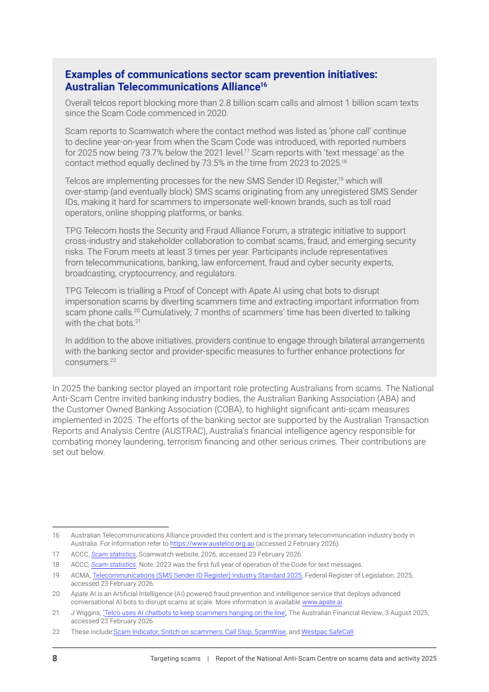

</details>

<!-- page 12 -->
## PDF page 12

### Examples of banking sector scam prevention initiatives:

### Large banks – Australian Banking Association (ABA)23

Confirmation of Payee

Confirmation of Payee is a key industry-wide initiative banks, building societies and credit
unions are rolling out to help protect customers from scams. It works as a payment-checking
service that verifies the name of the intended recipient against the account details entered
by the payer, before a transfer is completed. Where details do not match, customers are
alerted prior to authorisation, enabling them to pause, reconsider, and avoid potential scam or
error-based losses.

In late 2025, the Australian Banking Association (ABA), Australian Payments Plus (AP+) and the
Customer Owned Banking Association joined together in a collaborative initiative to promote
this new technology, in a national public awareness campaign.

The purpose of the campaign was to build awareness of how the new technology works and its
critical role in protecting people from the scourge of scams. The campaign achieved significant
reach across digital, broadcast and out-of-home channels, contributing to increased public
awareness and confidence when making account-to-account payments.

Individual bank case studies

Commonwealth Bank of Australia (CBA)

CBA has partnered with Apate.AI to deploy thousands of AI-powered conversational bots
to engage scammers, disrupt their operations and capture critical intelligence on scam
methodology. This intelligence is used in near real time to strengthen scam detection and help
protect CBA customers and the wider Australian community.

By proactively engaging scammers before they reach real victims, the technology provides
early insight into emerging scam typologies supporting faster intervention and more effective
prevention across the scams ecosystem.

Westpac

Westpac has launched SafeBlock, a customer-controlled security feature that allows
customers to instantly lock their accounts if they believe they are being targeted by a scam
or fraud.

Activated through the Westpac app or online, SafeBlock immediately prevents new payments,
transfers, card transactions and ATM withdrawals. SafeBlock enables immediate intervention
before a scam can progress.

23 ABA provided content for this information box. ABA is an association of 20 member banks in Australia, see https://www.
ausbanking.org.au for further information (accessed 6 January 2026).

### Links on this page

- [https://www.ausbanking.org.au](https://www.ausbanking.org.au)

<details>
<summary>PDF page 12: original layout / charts</summary>

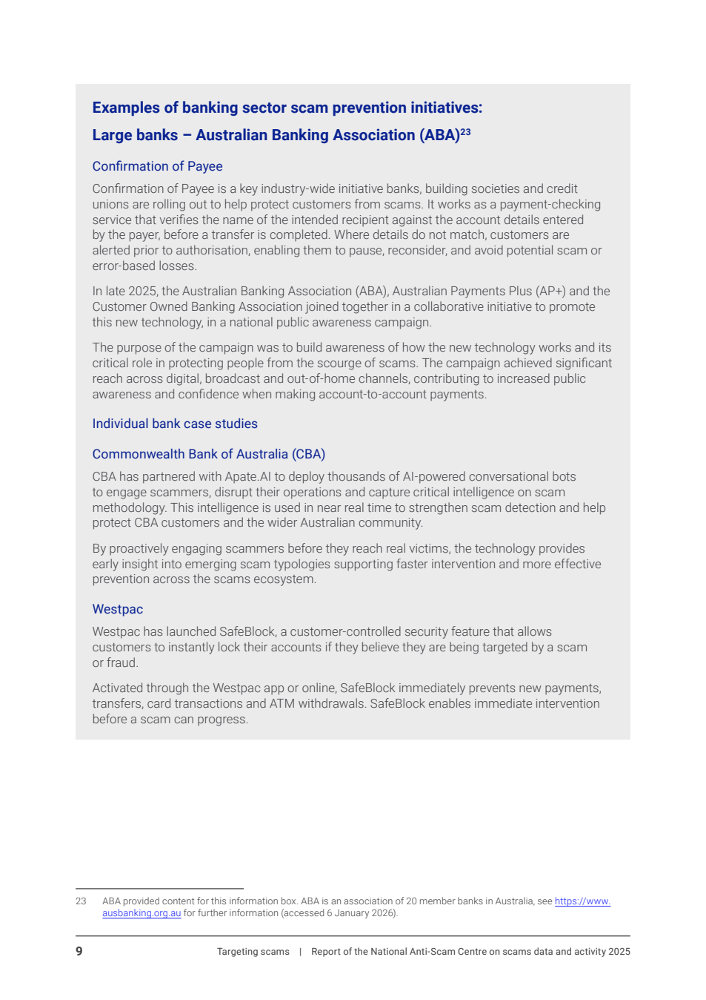

</details>

<!-- page 13 -->
## PDF page 13

National Australia Bank (NAB)

NAB introduced facial biometric identity verification for customers opening accounts and
products online. By requiring a selfie matched against a government ID, this feature helps
prevent identity theft and fraud at the point of onboarding.

This measure makes it harder for scammers to gain access to accounts, while complementing
NAB’s wider protections such as real-time payment alerts and safer digital banking practices.
Together, these initiatives help reduce the risk of scams and keep NAB customers’ money and
information secure.

Australia and New Zealand Banking Group (ANZ)

ANZ launched Digital Padlock, a feature that allows customers to instantly lock down access
to their accounts if they suspect scam activity. By giving customers real-time control, the tool
helps prevent unauthorised access.

By putting an immediate ‘kill switch’ in customers’ hands, Digital Padlock provides rapid
intervention at the point of suspected compromise. This empowers customers to stop scams
in real time while ANZ’s monitoring and response teams investigate, forming part of a broader,
layered approach to protecting Australians from financial fraud.

### Customer owned banks, mutuals, credit unions and building societies

### (COBA)24

The customer-owned banking sector has focused on the Scam Safe Accord initiatives
throughout 2025 and is now preparing for the Scams Prevention Framework. All members
are participating in the Fraud Reporting Exchange,25 making more than 3,000 requests for the
return of scam monies on behalf of customers. Roll out of the Confirmation of Payee initiative
continues with 82% of customer-owned banks having achieved implementation by the end
of 2025. COBA reports that its members continue to focus on increasing customer education
through conducting scam awareness campaigns across their communities.

24 COBA provided content for this information box. COBA is the industry association for Australia’s customer-owned banking
institutions, see https://www.customerownedbanking.asn.au for further information (accessed 6 January 2026).
25 AFCX, Fraud Reporting Exchange, AFCX, n.d., accessed 23 February 2026.

### Links on this page

- [https://www.customerownedbanking.asn.au](https://www.customerownedbanking.asn.au)
- [https://www.afcx.com.au/home-2/afcx-frx/](https://www.afcx.com.au/home-2/afcx-frx/)

<details>
<summary>PDF page 13: original layout / charts</summary>

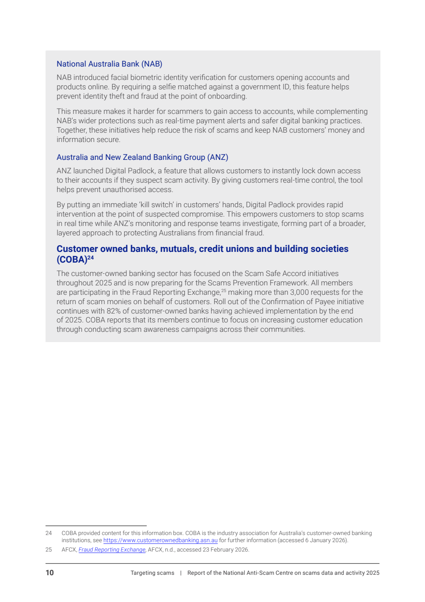

</details>

<!-- page 14 -->
## PDF page 14

### Anti-scam initiatives: Australian Transaction Reports and Analysis Centre

### (AUSTRAC)26

Tackling scam related harm linked to cryptocurrency ATMs

AUSTRAC is Australia’s financial intelligence unit and anti-money laundering and
counter-terrorism financing (AML/CTF) regulator. The agency oversees digital currency
exchanges providing certain Cryptocurrency ATM (Crypto ATM) services in Australia. Crypto
ATMs provide a non-face-to-face channel to exchange physical cash for cryptocurrency quickly
and are often accessible 24/7.

Crypto ATMs are attractive avenues for criminals looking to launder money or commit other
criminal activity, as they are widely accessible and make near-instant and irreversible transfers.
Australia has seen a considerable expansion in Crypto ATM numbers from around 20 in 2019 to
over 2000 in 2026, with an estimated $275 million in transactions conducted annually.

As part of a nationwide operation, AUSTRAC’s Crypto Taskforce made over 100 referrals to
federal, state and territory police. These law enforcement agencies engaged with more than
80 Australian high transacting Crypto ATM users:

ƒ The majority were scam victims or money mules who had been coerced into moving
suspected illicit funds through Crypto ATMs.

ƒ Tasmania Police Cyber Investigations identified no legitimate Crypto ATM activity across
the top 15 users by value in the state, with all users found to be the victim of a scam. The
investigation found the 15 victims had suffered combined losses of $2.5 million – including
about $900,000 deposited to Crypto ATMs.

Working in partnership with law enforcement, AUSTRAC estimates that 85% of the top Crypto
ATM users had been coerced into conducting transactions through Crypto ATMs by scam
perpetrators or were involved in money mule activity.

AUSTRAC’s Crypto Taskforce took action to disrupt criminal proceeds moving through Crypto
ATMs by applying conditions to all Crypto ATM operators, including a $5,000 limit on cash
deposits and withdrawals, enhanced customer due diligence obligations, mandatory scam
warnings, and requirements for more robust transaction monitoring. AUSTRAC also issued an
infringement notice to one Crypto ATM operator for failing to report threshold transactions and
refused to renew the registration of another operator.

Crypto ATM operators’ behaviour has changed following interventions from AUSTRAC’s Crypto
Taskforce. AUSTRAC has now seen examples of:

ƒ earlier identification and intervention for potential scam victims being asked to move their
money through Crypto ATMs

ƒ Crypto ATM operators arranging comprehensive reviews of their Anti-Money Laundering
and Counter-Terrorism Financing Act 2006 (AML/CTF Act) framework by qualified
professionals27

ƒ changes to reporting that better reflect the AML/CTF Act requirements and demonstrate
improvements in their risk understanding – helping to provide vital intelligence on illicit
activity.

26 AUSTRAC provided content for this information box.
27 AUSTRAC, AML/CTF Act, AUSTRAC website, 2025, accessed 23 February 2026.

### Links on this page

- [https://www.austrac.gov.au/business/legislation/amlctf-act](https://www.austrac.gov.au/business/legislation/amlctf-act)

<details>
<summary>PDF page 14: original layout / charts</summary>

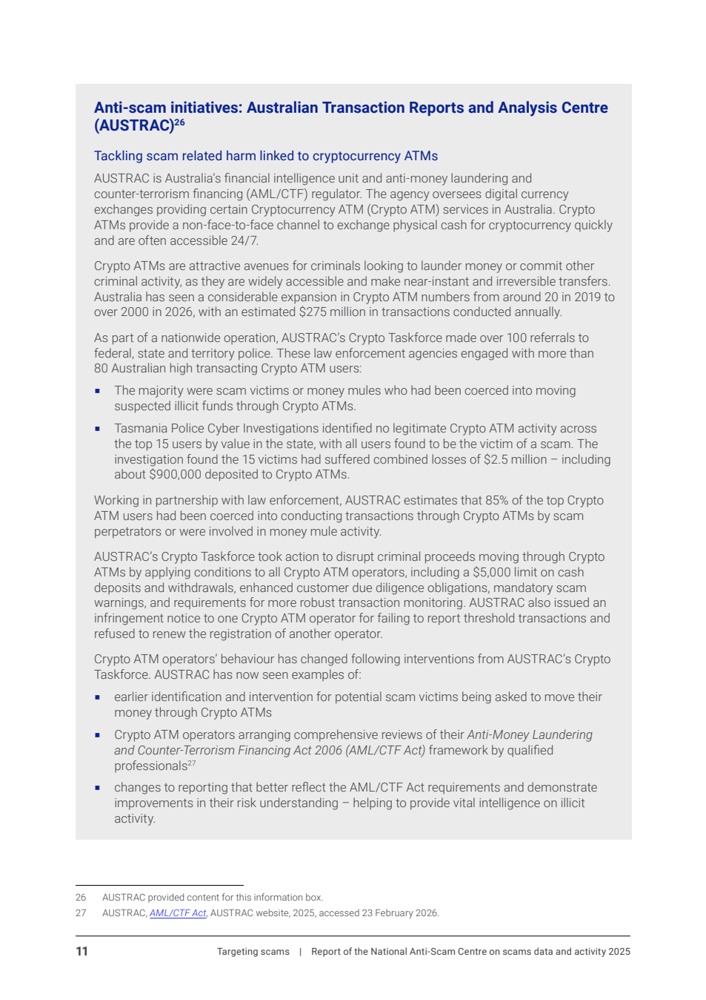

</details>

<!-- page 15 -->
## PDF page 15

### Website takedown service

The National Anti-Scam Centre facilitates the removal of scam websites by referring suspicious URLs
to its takedown service.

The National Anti-Scam Centre continues to improve its capability to identify and disrupt scam
websites before they cause widespread harm.28

### Website takedown service

### 8,400+ 89.6%

### $89.4m

URLs referred of URLs successfully
estimated avoided loss*
for takedown removed

*Based on average reported loss per reported URL.

There are a range of other initiatives by government agencies to remove online scam content.
Services Australia removes scam content impersonating its brands such as myGov and Centrelink.

In 2025 the National Anti-Scam Centre collaborated with the Australian Securities and Investments
Commission (ASIC) to disrupt investment scams, which included the removal of fake investment
platforms, phishing scams, cryptocurrency investment scams and investment scam advertisements
on social media. 29

### ASIC collaboration on website takedowns

### 2,400+ ASIC coordinated the removal of ASIC coordinated 90%

### URLs referred 11,964phishing and investment more URLs for removal via Scamwatch

to ASIC scam websites reports compared to 2024

In 2025 the ASIC played an important role in protecting Australians from investment scams. The
National Anti-Scam Centre invited ASIC to highlight key anti-scam initiatives. Their contribution is set
out below.

28 The National Anti-Scam Centre is implementing automated pre-assessment tools to support the referral of potential scam
website URLs, allowing it to process and assess over 60,000 websites a month. In future, this could increase its capability to
support the removal of more scam websites.
29 The National Anti-Scam Centre commenced automatically referring investment scams reported to its Scamwatch service to
ASIC in March 2024.

<details>
<summary>PDF page 15: original layout / charts</summary>

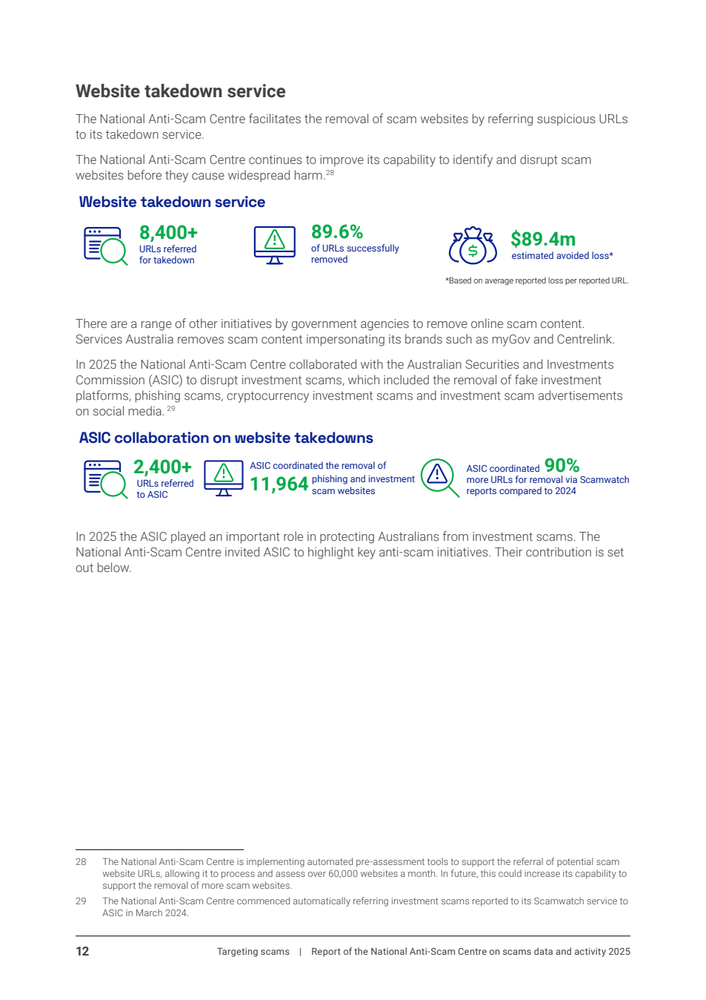

</details>

<!-- page 16 -->
## PDF page 16

### Anti-scam initiatives: Australian Securities and Investments Commission30

The Australian Securities and Investments Commission (ASIC) works in partnership with the
National Anti-Scam Centre to combat scams.

ASIC is Australia’s integrated corporate, markets, financial services and consumer credit
regulator and combatting scams remains one of ASIC’s strategic priorities.

ASIC’s scams work continues to focus on reducing the impact of investment scams on
Australians. In 2025, this included:

ƒ securing a longer-term investment scam website takedown provider to remove investment
scams and phishing websites, an average 230 per week, including those promoted by
advertising on digital platforms

ƒ listing companies, businesses and websites, on average 100 per month, suspected of being
a scam on Moneysmart’s Investor Alert List to warn consumers31

ƒ contributing alerts to the International Organization of Securities Commissions’ (IOSCO)32
International Securities & Commodities Alerts Networks (I-SCAN)33

ƒ regularly publishing consumer and investor warnings about investment scams and scams
in the financial services sector (including on our Moneysmart website)34

ƒ actively participating with the IOSCO Asia-Pacific Regional Committee Working Group
on Scams and Online Harms, including engaging with platform providers to mitigate and
disrupt scams in the Asia-Pacific region.

ASIC scams surveillance and enforcement work involved:

ƒ publishing an open letter to Superannuation Trustees following ASIC’s review of their
anti-scam practices35

ƒ charging 4 individuals with money laundering offences for their alleged involvement in
investment scams targeting individual investors through social media36

ƒ winding up 95 companies, many of which are believed to be associated with online
investment and romance scams37

ƒ charging one individual with money laundering offences who sought to open bank accounts
to receive and transfer deposits, despite bank accounts being repeatedly closed due to
concerns about scams.38

30 ASIC provided content for this information box.
31 ASIC, Investor alert list, Moneysmart website, n.d., accessed 16 January 2026.
32 International Organization of Securities Commissions (IOSCO), About IOSCO, ISOCO website, n.d., accessed 17 March 2026.
33 IOSCO, International Securities & Commodities Alerts Network (I-SCAN), IOSCO website, n.d., accessed 16 January 2026.
34 ASIC, ‘Scam alert: ASIC warns consumers about investment bond scam impersonating Bunnings’, ASIC, 3 February 2025,
accessed 16 January 2026; ASIC, ‘Scam alert: Scammers impersonating ASIC’s Moneysmart website’, ASIC, 16 October
2025, accessed 16 January 2026; ASIC, How to spot a scam website, Moneysmart website, n.d., accessed 16 January 2026.
35 ASIC, ‘ASIC calls out superannuation trustees for weak scam and fraud practices’, ASIC, 30 January 2025, accessed
16 January 2026.
36 ASIC, Four people charged with money laundering in fake investment scam [media release], ASIC, 7 August 2025, accessed
16 January 2026.
37 ASIC, ASIC warns of threat from “hydra-like” scammers after obtaining court orders to shut down 95 companies [media
release], ASIC, 7 April 2025, accessed 16 January 2026.
38 ASIC, ASIC charges Brendan Gunn for dealing with money reasonably suspected of being proceeds of crime [media release],
ASIC, 5 March 2025, accessed 16 January 2026.

### Links on this page

- [https://moneysmart.gov.au/check-and-report-scams/investor-alert-list](https://moneysmart.gov.au/check-and-report-scams/investor-alert-list)
- [https://www.iosco.org/v2/about/?subsection=about_iosco](https://www.iosco.org/v2/about/?subsection=about_iosco)
- [https://www.iosco.org/i-scan/](https://www.iosco.org/i-scan/)
- [https://www.asic.gov.au/about-asic/news-centre/news-items/scam-alert-asic-warns-consumers-about-investment-bond-scam-impersonating-bunnings/](https://www.asic.gov.au/about-asic/news-centre/news-items/scam-alert-asic-warns-consumers-about-investment-bond-scam-impersonating-bunnings/)
- [https://www.asic.gov.au/about-asic/news-centre/news-items/scam-alert-scammers-impersonating-asic-s-moneysmart-website/](https://www.asic.gov.au/about-asic/news-centre/news-items/scam-alert-scammers-impersonating-asic-s-moneysmart-website/)
- [https://moneysmart.gov.au/online-safety/how-to-spot-a-scam-website](https://moneysmart.gov.au/online-safety/how-to-spot-a-scam-website)
- [https://www.asic.gov.au/about-asic/news-centre/news-items/asic-calls-out-superannuation-trustees-for-weak-scam-and-fraud-practices/](https://www.asic.gov.au/about-asic/news-centre/news-items/asic-calls-out-superannuation-trustees-for-weak-scam-and-fraud-practices/)
- [https://www.asic.gov.au/about-asic/news-centre/find-a-media-release/2025-releases/25-156mr-four-people-charged-with-money-laundering-in-fake-investment-scam/](https://www.asic.gov.au/about-asic/news-centre/find-a-media-release/2025-releases/25-156mr-four-people-charged-with-money-laundering-in-fake-investment-scam/)
- [https://www.asic.gov.au/about-asic/news-centre/find-a-media-release/2025-releases/25-052mr-asic-warns-of-threat-from-hydra-like-scammers-after-obtaining-court-orders-to-shut-down-95-companies/](https://www.asic.gov.au/about-asic/news-centre/find-a-media-release/2025-releases/25-052mr-asic-warns-of-threat-from-hydra-like-scammers-after-obtaining-court-orders-to-shut-down-95-companies/)
- [https://www.asic.gov.au/about-asic/news-centre/find-a-media-release/2025-releases/25-030mr-asic-charges-brendan-gunn-for-dealing-with-money-reasonably-suspected-of-being-proceeds-of-crime/](https://www.asic.gov.au/about-asic/news-centre/find-a-media-release/2025-releases/25-030mr-asic-charges-brendan-gunn-for-dealing-with-money-reasonably-suspected-of-being-proceeds-of-crime/)

<details>
<summary>PDF page 16: original layout / charts</summary>

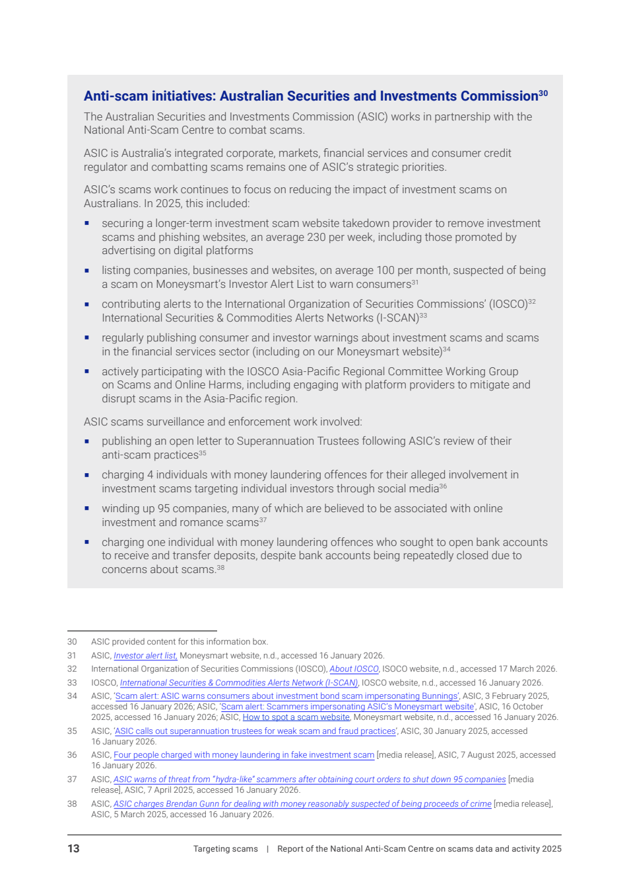

</details>

<!-- page 17 -->
## PDF page 17

Consistent with the whole of ecosystem approach to combating scams, the digital industry, including
social media platforms and messaging applications, have an important role to play in protecting
Australians from scams. The National Anti-Scam Centre invited peak industry body, Digital Industry
Group Inc. (DIGI),39 to highlight key anti-scam initiatives in 2025. Their contribution is set out below.

### Examples of anti-scam initiatives: Digital Industry Group Inc. (DIGI)40

In 2025, the Digital Industry Group Inc. (DIGI) continued to offer the voluntary Australian Online
Scams Code (the voluntary Code), a blueprint for combatting scams in the digital industry in
advance of the Government’s forthcoming mandatory codes for banking, telecommunications
and digital platforms. The voluntary Code outlines the 38 commitments made by leading
technology companies in Australia to fight scams, in 9 different areas including blocking
and takedown, advertiser verification and increased collaboration with Australia’s National
Anti-Scam Centre.41

In 2025 signatories also:

ƒ supported law enforcement efforts to disrupt scam operations globally, including through
more proactive litigations against offshore scammers to stop criminal activity at the source

ƒ introduced new technology to disrupt scams, such as Google’s AI backed in-call scam
detection which deters Australians from answering calls likely to be from scammers.

Voluntary Code signatories also invested in awareness and prevention initiatives such as,
Google’s Project BRIDGE (Building Resilience, Inclusion & Digital Growth for Elders) aimed
at improving digital resilience among older Australians and delivered in partnership with
the Council on the Ageing (COTA). Meta also partnered with IDCARE to deliver an education
campaign teaching people how to spot scams and tips to stay safe online, which reached over
7 million people and had over 23 million impressions.

### Data and intelligence sharing with stakeholders

Data sharing is critical to the success of Australia’s scam disruption efforts. It provides a more
complete picture of scam activity impacting Australians allowing the National Anti-Scam Centre to
turn data into insights and action.

The National Anti-Scams Centre’s data sharing technology allows authorised partners to access
timely and relevant information via a data partner portal or tailored Application Programming
Interfaces (APIs). Strengthened data security and access control ensures sensitive information is
only shared with appropriate parties.

By integrating data from multiple sources, the platform helps identify patterns, detect emerging
threats earlier and reduce duplication of effort across the ecosystem. Near real time sharing
improves coordination allowing for faster, more informed responses to protect Australians
from scams.

39 DIGI is an industry association for the digital industry in Australia, see https://digi.org.au (accessed 4 February 2026).
40 DIGI provided content for this information box.
41 The full measures signatories have committed to are outlined within the Australian Online Scams Code, which is available at
digi.org.au/scams.

### Links on this page

- [https://digi.org.au/scams/](https://digi.org.au/scams/)
- [https://digi.org.au](https://digi.org.au)
- [https://digi.org.au/scams](https://digi.org.au/scams)

<details>
<summary>PDF page 17: original layout / charts</summary>

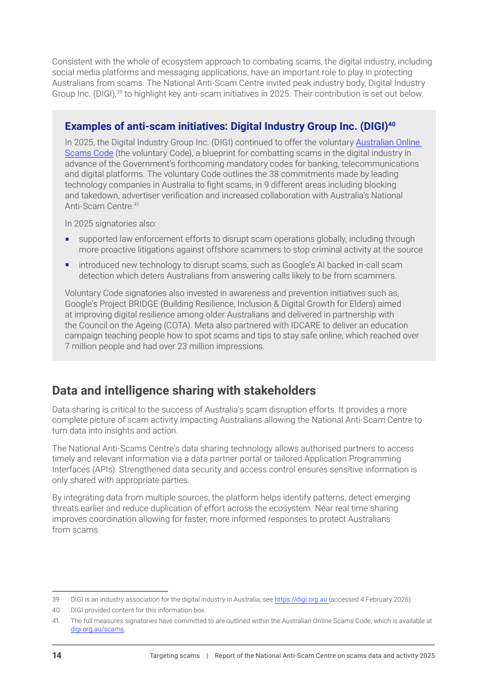

</details>

<!-- page 18 -->
## PDF page 18

The National Anti-Scam Centre continues to expand our data sharing capability. In addition to
Scamwatch data, the National Anti-Scam Centre now brings together data from a range of other
government and business data partners. At the end of 2025, there were over 40 established data
sharing arrangements with partners. This includes telcos, digital platforms, banks and financial
service providers (including cryptocurrency exchanges), government and law enforcement entities.

### Fusion Cells to combat scams

During 2025 the National Anti-Scam Centre led the Job Scam Fusion Cell and Romance Scam
Fusion Cell.42

Fusion cells are time-limited taskforces which bring together expertise from government, law
enforcement, and the private sector to address specific, urgent scam issues. Fusion cell objectives
included the identification of scam campaigns and their enabling technologies, disruption (the
blocking of scam enablers), identifying barriers to prevention, and developing resources to
support victims.

Participant organisations work together to share intelligence and identify opportunities for improved
collaboration and disruption. Fusion cells provide a creative and innovative platform for members to
test new approaches to disrupt scam enablers and promote scams awareness and education.

Key outcomes from the 2 most recent fusion cells include:

Job scams:

ƒ Removal of over 29,000 scam social media accounts and 1,850 fake job advertisements.

ƒ Disruption of over 800 scammer cryptocurrency wallets.

Romance scams:

ƒ Established new frameworks for sharing suspected pre-scam transactions, stopping the theft of
funds before it occurs.

ƒ Developed an Online Relationship Health Check,43 a 20-question self-assessment tool to help
people identify romance scam risk factors in their relationships.

ƒ 1,004 suspected scam transactions and 168 suspect scam cryptocurrency wallet addresses
referred for investigation, blocking, and blacklisting.

ƒ Developed 3 frontline response guides for bank staff, law enforcement, and support workers and
carers to promote consistent, trauma informed scam identification, disengagement, and referral.

42 The Job Scam Fusion Cell final report was published in May 2025 and the Romance Scam Fusion Cell final report was
published in March 2026 https://www.nasc.gov.au/reports-and-publications/fusion-cells.
43 The National Anti-Scam Centre’s Online Relationship Health Check tool is available at: Online relationship health check |
Scamwatch.

### Links on this page

- [https://www.nasc.gov.au/reports-and-publications/fusion-cells](https://www.nasc.gov.au/reports-and-publications/fusion-cells)
- [https://www.scamwatch.gov.au/research-and-resources/resources/online-relationship-health-check](https://www.scamwatch.gov.au/research-and-resources/resources/online-relationship-health-check)

<details>
<summary>PDF page 18: original layout / charts</summary>

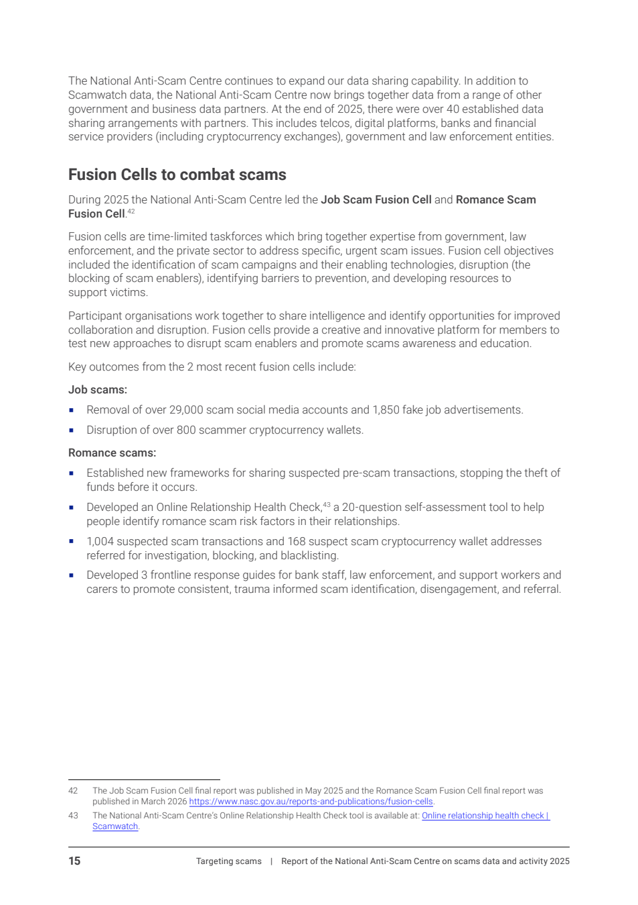

</details>

<!-- page 19 -->
## PDF page 19

### Consumer story: Romance Scam

Lisa matched with ‘Justin’, a criminal who had set up a profile on an online dating platform. He
told her he usually lived in Australia but was about to start working overseas in Saudi Arabia for
3 months.

Justin asked to move the conversation from the online dating platform where they had
matched, to the encrypted messaging platform WhatsApp, which is a common tactic
of romance scammers. He shared personal details about his life, and their relationship
became more serious. He told Lisa he was going to return to Australia after his work trip
was completed.

After a few weeks of being in contact, Justin told Lisa that his passport had been taken by the
government in Saudi Arabia, and he needed US$500 to get it back. Lisa was going to send
the money to him but wasn’t sure how to do the overseas transfer. He then asked her if she
could send an additional US$2,000 to pay for a new plane ticket, as his ticket to Australia had
been cancelled.

Lisa began looking into how to transfer the money, but she also confided in a friend, who
was suspicious of this new online friend’s behaviour. Her friend suggested she complete the
National Anti-Scam Centre’s Online Relationship Health Check. She realised after completing
the questions that Justin’s behaviour matched a lot of scammer behaviours, and that it was
very likely he was a scammer. Lisa didn’t send any money and has stopped replying to his
messages.

### Collaboration with law enforcement agencies

The National Anti-Scam Centre works with the Australian Federal Police (AFP), including by staff
secondment to the AFP-led Joint Policing Cybercrime Coordination Centre (JPC3), and AFP
membership of the National Anti-Scam Centre Advisory Board and working groups. Participation
in the JPC3 allows the National Anti-Scam Centre to rapidly share information across government,
industry and law enforcement, supporting scams disruption and prevention efforts.

### Operation Firestorm

The National Anti-Scam Centre continued to support Operation Firestorm, a global operation
launched by the JPC3 in August 2024, to address and disrupt offshore organised crime networks
deceiving Australians through romance, cryptocurrency and investment scams.

Following a raid on a Manila-based call centre in the Philippines involved in a coordinated
romance-baiting scam, the AFP identified Australian targets of the scam and provided their contact
details to the National Anti-Scam Centre.

Using this information, the National Anti-Scam Centre notified more than 5,000 potential victims,
urging them not to send money to people they had met online and outlining steps to take if they had
already sent money to the scammers.44 This proactive notification campaign helped prevent further
financial and psychological harm and contributed to disrupting the syndicate’s operations.

44 More information on the operation can be found in the National Anti-Scam Centre’s joint media release with the AFP,
Philippines Presidential Anti-Organized Crime Commission and National Bureau of Investigation https://www.nasc.gov.au/
news/more-than-5000-australian-victims-receive-text-warning-over-romance-scam.

### Links on this page

- [https://www.scamwatch.gov.au/research-and-resources/resources/online-relationship-health-check](https://www.scamwatch.gov.au/research-and-resources/resources/online-relationship-health-check)
- [https://www.nasc.gov.au/news/more-than-5000-australian-victims-receive-text-warning-over-romance-scam](https://www.nasc.gov.au/news/more-than-5000-australian-victims-receive-text-warning-over-romance-scam)

<details>
<summary>PDF page 19: original layout / charts</summary>

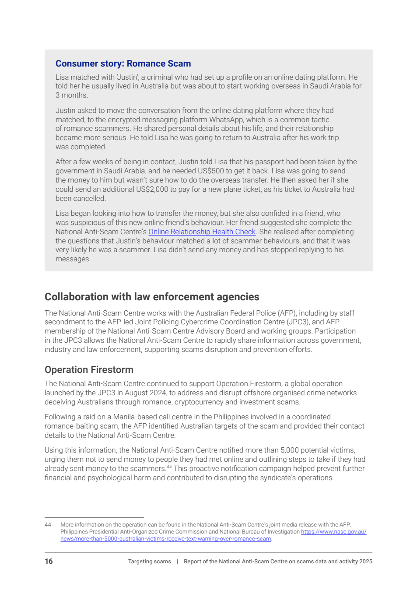

</details>

<!-- page 20 -->
## PDF page 20

Additionally, the AFP supported Royal Thai Police during a raid on a scam call centre in Bangkok in
June 2025, where scammers were operating an investment scam targeting Australians. The National
Anti-Scam Centre provided intelligence during the operation and subsequent investigation and has
notified nearly 2,000 potential victims of the scam.

### JPC3 Cryptocurrency scam disruption

The National Anti-Scam Centre continued to share scammer cryptocurrency wallet addresses
with law enforcement and industry partners via the AUSTRAC-led Fintel Alliance.45 The National
Anti-Scam Centre extracts tainted wallet addresses from Scamwatch reports and shares them with
digital currency exchanges (DCEs) for analysis and investigation. In 2025, the National Anti-Scam
Centre shared 1,548 scammer wallet addresses, supporting the blocking and blacklisting of wallets
and other actions that disrupt scam activity.

### International engagement

The National Anti-Scam Centre’s ongoing international engagement reflected the evolving
and persistent nature of scam activity worldwide. Scams are a global threat, and international
collaboration is important in preventing and disrupting scams.

Among the global community, Australia is seen as leading the fight against scams. The National
Anti-Scam Centre continued to assist global stakeholders as they seek guidance in establishing their
own anti-scam approaches.46 By sharing insights and learnings, countries are supported to fight
scams in their regions.

The National Anti-Scam Centre recognises the strategic importance of strong partnerships with
counterpart agencies to collaborate on the shared challenge of fighting scams. This includes
membership on the International Fraud Council and regular joint meetings with the UK Home Office,
Stop Scams UK,47 National Crime Agency and the City of London Police.

Highlights of our engagement in 2025:

ƒ Participating in scam knowledge sharing opportunities such as the International Consumer
Protection and Enforcement Network (ICPEN) annual conference and Bank of International
Settlements Innovation Hub. This sharing of information helps countries to learn from consumer
protection best practices.48

ƒ Delivering anti-scams workshops supporting the Association of Southeast Asian Nations
(ASEAN) member states to uplift consumer protection efforts.49

ƒ Collaboration with national policing agencies to combat transnational cybercrime. This includes:

– providing intelligence support and an intelligence analyst secondee to AFP Operation
Firestorm which has a strong focus on domestic and international collaboration

– participation in FRONTIER+,50 the Singapore-police led initiative to share scam intelligence
between anti-scam centres across the Asia Pacific

– informing Australian suspected scam victims based on referrals from overseas agencies.

45 AUSTRAC, Fintel Alliance, AUSTRAC website, 2025, accessed 17 March 2026.
46 The National Anti-Scam Centre responded to enquiries from a number of global stakeholders including the Dutch Police,
Central Bank of the Philippines, Government of Aruba, Israeli National Cyber Directorate and various Indonesian delegations.
47 Stop Scams UK, Stop Scams UK [website], n.d., accessed 17 March 2026.
48 ICPEN is a global consumer protection network comprised of authorities from over 80 countries, which through international
cooperation, coordination, and collaboration, promotes cross border consumer protection issues, including online scams.
49 Association of Southeast Asian Nations (ASEAN), About ASEAN, ASEAN website, n.d., accessed 17 March 2026.
50 Singapore Police Force, Operation FRONTIER+: A Unified Front Against Transnational Scams, Singapore Police Force website,
2025, accessed 17 March 2026.

### Links on this page

- [https://www.austrac.gov.au/partners/fintel-alliance](https://www.austrac.gov.au/partners/fintel-alliance)
- [https://stopscamsuk.org.uk/](https://stopscamsuk.org.uk/)
- [https://asean.org/about-asean](https://asean.org/about-asean)
- [https://www.police.gov.sg/Media-Hub/Police-Life/2025/08/Operation-FRONTIER-A-United-Front-Against-Transnational-Scams](https://www.police.gov.sg/Media-Hub/Police-Life/2025/08/Operation-FRONTIER-A-United-Front-Against-Transnational-Scams)

<details>
<summary>PDF page 20: original layout / charts</summary>

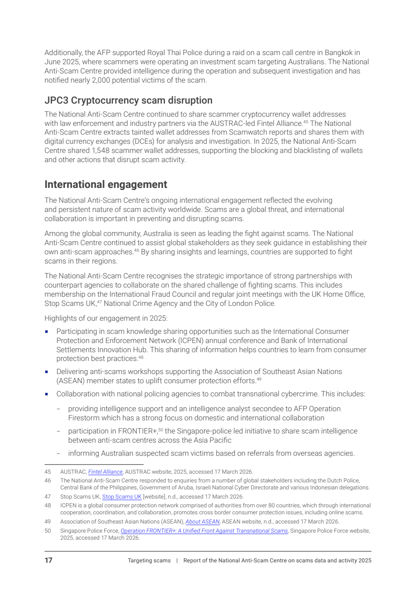

</details>

<!-- page 21 -->
## PDF page 21

ƒ Championing the need for a global data sharing and alert system where organisations from
across the globe can feed in data. Global awareness of scam threat vectors in near-real time is
needed to effectively disrupt scammer activity that crosses international borders. The National
Anti-Scam Centre has also made a commitment to explore further data sharing opportunities
through the Global Signals Exchange.51

### International engagement initiative: Joining the Global Anti-Scam Alliance

### (GASA) Advisory Board52

In November 2025, the National Anti-Scam Centre became a Member of the GASA Advisory
Board for a period of 12 months.

Australia’s strong experience and leadership in cross-sector cooperation, innovative disruption,
regulation and public awareness can guide best practices globally. As a member, the National
Anti-Scam Centre will share expertise and strengthen collaboration with governments, law
enforcement, industry and consumer advocates worldwide to protect people from the harm.

Given the global nature of scams participation at international events helps identify
opportunities for global collaboration and build relationships to deliver the National Anti-Scam
Centre program in Australia to protect people from the harm caused by scams.

GASA runs regional summits throughout the year bringing together experts from around
the world to share insights on scams in their region. In 2025, the National Anti-Scam Centre
participated in 2 of these summits.

### Global Anti-Scam Summit Europe – March 2025

Hosted by the UK Home Office, this summit provided the opportunity to further relationships
with key stakeholders across government, industry, law enforcement and consumer advocates.
This included exploring future data sharing arrangements. Insights gained on the current state
of scams internationally and scams that were affecting specific countries were shared with the
National Anti-Scam Centre disruption team to stay on top of current scam trends.

### Global Anti-Scam Summit Asia – September 2025

This event was sponsored by the Singapore Ministry of Digital Development and Information,
Ministry of Home Affairs and Singapore Police Force. The National Anti-Scam Centre shared
impacts of its ‘Stop. Check. Protect.’ advice and was encouraged to see other countries
adopting a similar call to action to educate and protect their citizens and increasing consistency
in anti-scam messaging. The National Anti-Scam Centre also participated in forums about new
agentic AI scam threats, innovative bot to bot intelligence gathering, and disruption of scam
compounds (led by the United Nations). There was also significant interest in the Australia’s
fusion cell model as a successful example for coordinated, targeted collaboration across
government, industry, law enforcement and consumer organisations.

51 In October 2024, Google announced the Global Signal Exchange, a partnership with the Global Anti-Scam Alliance and DNS
Research Federation, aiming to improve the exchange of abuse signals, enabling faster identification and disruption of
fraudulent activities across various sectors, platforms and services to tackle online scams.
52 GASA is a Dutch organisation that aims to protect consumers worldwide from scams through global coordination, see
https://www.gasa.org for further information (accessed 16 January 2026).

### Links on this page

- [https://www.gasa.org](https://www.gasa.org)

<details>
<summary>PDF page 21: original layout / charts</summary>

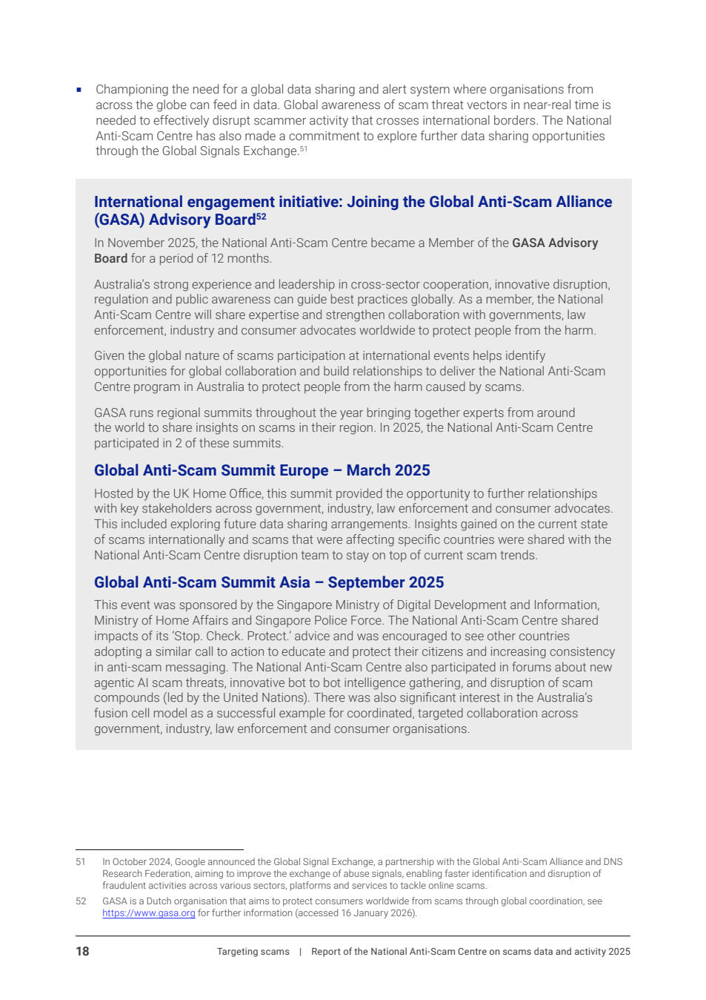

</details>

<!-- page 22 -->
## PDF page 22

In 2025 the Department of Foreign Affairs and Trade (DFAT) played an important role in coordinating
Australia’s efforts in combating online scam centres. The National Anti-Scam Centre invited DFAT to
highlight key anti-scam initiatives in 2025. Their contribution is set out below.

### Combatting online scam operations internationally, including trafficking

### for forced criminality: Department of Foreign Affairs and Trade (DFAT)53

Australia’s ongoing efforts to combat online scam operations were reinforced through its
role as co-chair of the Bali Process on People Smuggling, Trafficking in Persons and Related
Transnational Crime (with Indonesia) and under the ASEAN-Australia Counter Trafficking
Program (ASEAN-ACT).

Through a series of regional workshops, the Bali Process Regional Support Office – which is
part-funded by Australia – strengthened law enforcement officers’ skills in investigating the
trafficking of persons into forced criminality in online scam operations.

To help identify and address risks of digital platforms and services being used in trafficking
in persons and online scam operations, ASEAN-ACT, in collaboration with the Global
Initiative against Transnational Crime, established the Industry Policy Working Group with
representatives from technology, telecommunications and finance companies. The group is
developing a set of principles and approaches to better prevent and respond to trafficking for
forced criminality.

The Department of Foreign Affairs and Trade continued to raise awareness of the threat of
online scam operations to regional peace, security and resilience in multilateral and regional
forums. Australia’s Ambassador to Counter Modern Slavery, People Smuggling and Human
Trafficking, Ms Jane Duke, led the diplomatic effort. At the November 2025 UN General
Assembly High Level Meeting on the Global Plan of Action to Combat Trafficking in Persons,
Ambassador Duke co-facilitated a session on technology-enabled trafficking and forced
criminality which highlighted the importance of cross-sector collaboration.

In December 2025, Australia and the United States committed to establish a bilateral,
interagency Working Group to Combat Online Scam Operations to strengthen cooperation and
collaboration to boost regional resilience, security and capacity.

53 DFAT provided content for this information box.

<details>
<summary>PDF page 22: original layout / charts</summary>

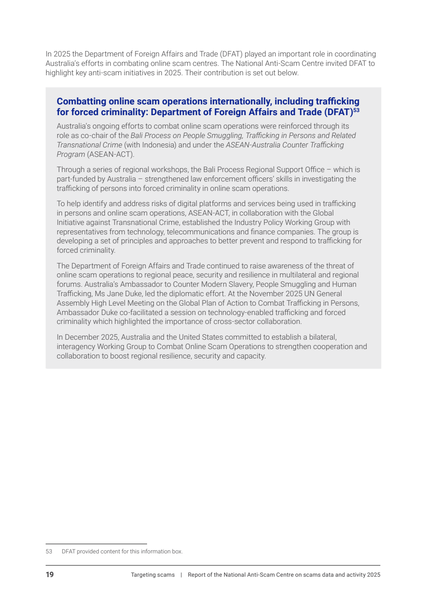

</details>

<!-- page 23 -->
## PDF page 23

### Consumer awareness

### Community engagement

The National Anti-Scam Centre is committed to increasing consumer awareness to empower
Australians to identify, avoid and report scams. All metrics for community engagement shown below
reflect an upward trend on 2024 performance (excluding social media engagements).

The National Anti-Scam Centre communication channels target government and business
stakeholders while its Scamwatch channels are aimed at consumers. The ACCC Facebook and
Instagram channels are also leveraged to reach a broader consumer audience with high priority
anti-scam messaging.

### Website engagement

### 6,567,934 171,436

views of Scamwatch website^ views of National Anti-Scam Centre website^
from 3,300,225 users^^ (approx.) from 109,980 users^^ (approx.)

^Views: The number of page views on the website. A single user can have multiple page views.
^^Users: The number of distinct users who visited the website.

Reach and impact of social media channelsx

### 184 2.1k 931k+ 29k+

posts shares/reposts impressions/views engagements

x On organic posts across Scamwatch Instagram, National Anti-Scam Centre LinkedIn and X, and ACCC Facebook and Instagram (scams related posts only).

### Supporting people and communities to stay safe from scams

The National Anti-Scam Centre aims to empower people who may be at increased risk of harm from
scams, through its Outreach program. This includes First Nations communities, older Australians,
youth, people from culturally and linguistically diverse (CALD) backgrounds, those living with a
disability and small businesses.

In 2025, the National Anti-Scam Centre established new, and enriched existing, relationships with a
range of key stakeholders. This resulted in several joint initiatives, including:

ƒ A segment on Vision Australia radio (a channel tailored for the vision-impaired community with
over 460,000 listeners) to discuss the importance of scam conversations to reduce stigma and
give practical tips to help listeners stay safe.

ƒ An episode on Adult Multicultural Education Services (AMES) Australia’s Australian life podcast
series, aimed at supporting newly arrived migrants settle into life in Australia,54 to educate CALD
listeners to identify and avoid impersonation scams.

ƒ Publication of new scams guidance for small businesses,55 and the delivery of scams awareness
webinars for small businesses during Cyber Awareness Month, hosted separately by the National

54 The podcast is currently available on Spotify and Apple Podcasts in English, Persian, Chin Hakha, and Karen.
55 ACCC, Small business scams guidance [PDF 308.68KB], Scamwatch, 2025, accessed 24 February 2026.

### Links on this page

- [https://open.spotify.com/show/4PQl96lTyqF1OPXxt0SvB2](https://open.spotify.com/show/4PQl96lTyqF1OPXxt0SvB2)
- [https://podcasts.apple.com/au/podcast/australian-life-podcast-by-ames-australia/id1522997835](https://podcasts.apple.com/au/podcast/australian-life-podcast-by-ames-australia/id1522997835)
- [https://www.scamwatch.gov.au/system/files/small-business-scams-guidance_1.pdf](https://www.scamwatch.gov.au/system/files/small-business-scams-guidance_1.pdf)

<details>
<summary>PDF page 23: original layout / charts</summary>

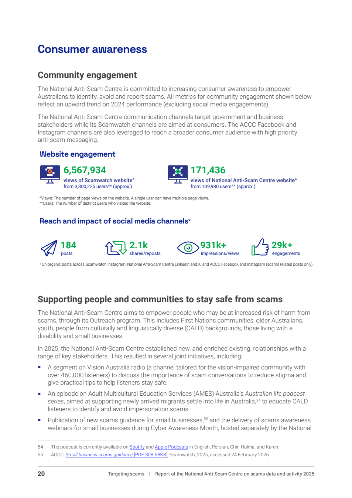

</details>

<!-- page 24 -->
## PDF page 24

Office of Cyber Security, the NSW Small Business Commission, and the QLD Department of State
Development, Infrastructure and Planning.

ƒ Co-design of the Ecstra Foundation’s ‘Becoming scam savvy’ workshop, a new, engaging, and
practical workshop from Talk Money,56 created to help high school students years 7 to 10 to
recognise scam red flags and stay safe.

ƒ Co-design and distribution of tailored First Nations Scamwatch resources,57 distributed at over
40 outreach events attended by the ACCC’s First Nations liaison representatives.

ƒ Recording and publishing a scams awareness presentation with The Council of the Aging NSW
(COTA NSW).58

ƒ Providing scam prevention guidance about the new social media minimum age laws, in
collaboration with the Office of the eSafety Commissioner.59

ƒ Delivering a scams awareness session to people at risk of vulnerability from the African
community in Cairns, in partnership with Services Australia, the Department of Home Affairs and
the Cairns African Association.

ƒ Delivering a 4-part podcast series with NITV Goodways on the impact of scams on First Nations
communities and advice on how to stay safe. 60

The National Anti-Scam Centre’s flagship publication The Little Book of Scams: How to spot and
avoid scams is available in 18 languages, as well as a First Nations and Easy Read version. Digital
versions are available for download on the Scamwatch website,61 though printed copies remain in
high demand, as it is widely recognised as a valuable scam prevention product for more vulnerable
consumers, who may have difficulty accessing or engaging with digital resources.

### Community and consumer initiatives

### 55 Little Book

### 158,182 10,269

of Scams
Scams awareness
distribution: printed copies downloads
presentations

In 2025, Services Australia’s response to scams impersonating its brands and platforms played an
important role in raising awareness and helping consumers identify and avoid scams. The National
Anti-Scam Centre invited Services Australia to highlight important anti-scam initiatives in 2025. Their
contribution is set out below.

56 Ecstra Foundation, Talk money [website], n.d., accessed 17 March 2026.
57 ACCC, Resources for First Nations peoples, Scamwatch website, 2025, accessed 24 February 2026.
58 Council on the Ageing (COTA) NSW and the National Anti-Scam Centre, ‘COTA NSW & Scamwatch Present – Stop. Better
Safe than Scammed’ [video], COTA NSW, YouTube, 10 July 2025, accessed 24 February 2026.
59 eSafety Commissioner, Social media ‘ban’ or delay FAQs, eSafety website, 2026, accessed 17 March 2026.
60 R Roberts and S Wellington, ‘Goodways: Scams Awareness – Online shopping scams and catfishing’ [podcast], SBS website,
18 February 2025, accessed 24 February 2026; R Roberts and S Wellington, ‘Goodways: Scams Awareness – Let’s Stay
Safe Online Together’ [podcast], SBS website, 24 February 2025, accessed 24 February 2026; R Roberts and S Wellington,
‘Goodways: Scams Awareness – Financial Scams’ [podcast], SBS website, 3 March 2025, accessed 24 February 2026;
R Roberts and S Wellington, ‘Goodways: Scams Awareness – Scams and Our Communities’ [podcast], SBS website,
18 March 2025, accessed 24 February 2026.
61 ACCC, The Little Book of Scams, Scamwatch website, 2024, accessed 24 February 2026.

### Links on this page

- [https://talkmoney.org.au/](https://talkmoney.org.au/)
- [https://www.scamwatch.gov.au/research-and-resources/resources/resources-for-first-nations-peoples](https://www.scamwatch.gov.au/research-and-resources/resources/resources-for-first-nations-peoples)
- [https://www.youtube.com/watch?v=AliY2r1BKiw](https://www.youtube.com/watch?v=AliY2r1BKiw)
- [https://www.esafety.gov.au/about-us/industry-regulation/social-media-age-restrictions/faqs#ive-been-asked-to-prove-my-age--how-can-i-tell-if-its-a-scam](https://www.esafety.gov.au/about-us/industry-regulation/social-media-age-restrictions/faqs#ive-been-asked-to-prove-my-age--how-can-i-tell-if-its-a-scam)
- [https://www.sbs.com.au/nitv/podcast-episode/goodways-scams-awareness-online-shopping-scams-and-catfishing/egtjuxs5o](https://www.sbs.com.au/nitv/podcast-episode/goodways-scams-awareness-online-shopping-scams-and-catfishing/egtjuxs5o)
- [https://www.sbs.com.au/nitv/podcast-episode/goodways-scams-awareness-lets-stay-safe-online-together/trhjdoqsc](https://www.sbs.com.au/nitv/podcast-episode/goodways-scams-awareness-lets-stay-safe-online-together/trhjdoqsc)
- [https://www.sbs.com.au/nitv/podcast-episode/goodways-scams-awareness-financial-scams/5kwngxraq](https://www.sbs.com.au/nitv/podcast-episode/goodways-scams-awareness-financial-scams/5kwngxraq)
- [https://www.sbs.com.au/nitv/podcast-episode/goodways-scams-awareness-scams-and-our-communities/3iian5qfp](https://www.sbs.com.au/nitv/podcast-episode/goodways-scams-awareness-scams-and-our-communities/3iian5qfp)
- [https://www.scamwatch.gov.au/research-and-resources/the-little-book-of-scams](https://www.scamwatch.gov.au/research-and-resources/the-little-book-of-scams)

<details>
<summary>PDF page 24: original layout / charts</summary>

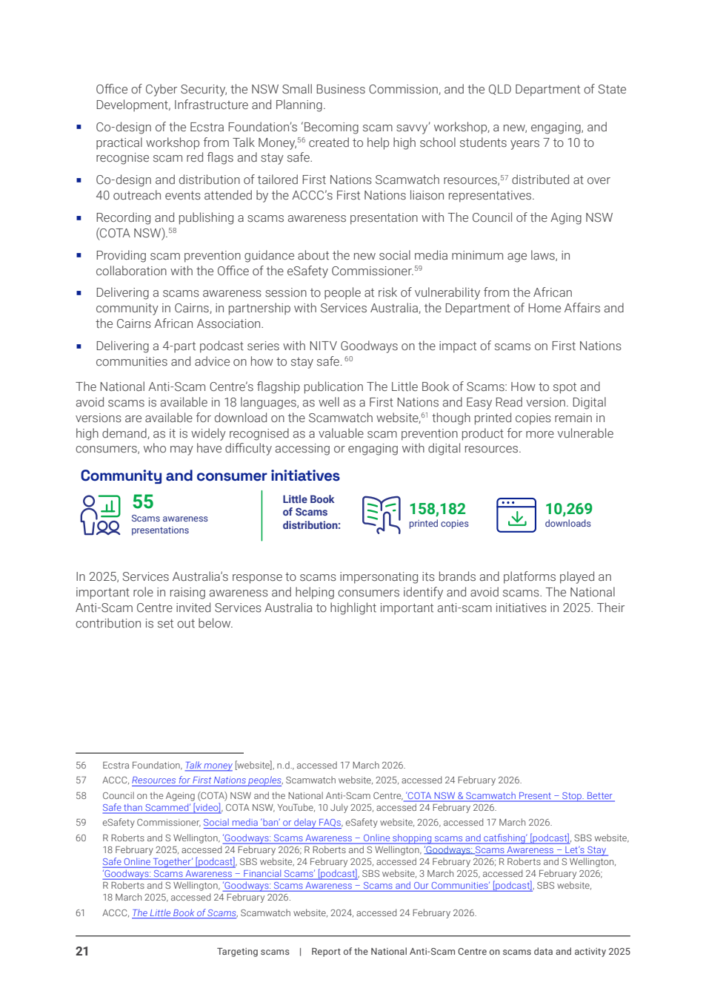

</details>

<!-- page 25 -->
## PDF page 25

### Community protection and response initiatives: Services Australia62

Scams Response

Services Australia has a dedicated Scams Response Team that coordinates activity and
engagement to detect and respond to scams relating to its brands and platforms, such as
myGov. Throughout 2025, Services Australia detected and responded to over 14,000 unique
agency impersonation scams and supported over 9,000 customers affected by agency
impersonation scams through the Scams and Identity Theft Helpdesk. Notably, the agency
observed a trend decrease in scam activity throughout 2025.

Scams prevention and engagement

Services Australia delivers a broad range of scams prevention and community engagement
activities to help Australians protect their identity and avoid harm from scams. In 2025,
Services Australia worked closely with the National Anti-Scam Centre to design and deliver
joint scams awareness initiatives at several community events. These collaborations leveraged
Services Australia’s national geographic footprint to provide scams awareness to all areas of
Australia. At community events, Services Australia shared the Little Book of Scams alongside
agency scams prevention merchandise, providing practical, trusted take home resources that
reinforce key messages beyond the events. Services Australia also developed tailored scams
information and trained over 250 agency specialist staff to help vulnerable, Indigenous and
multicultural Australians protect their identity and avoid scams.

Strengthening myGov

myGov supports millions of Australians to securely access their government services online
each week. In 2025, Services Australia strengthened myGov by promoting stronger sign in
options and implemented better controls to better protect customer information and reduce
the risk of account compromise. These improvements included Passkeys and Digital ID
sign in options and a dynamic security review dashboard which provides tailored actions to
strengthen accounts. Users are encouraged to adopt stronger sign in options and turn off their
username and password to make their accounts more phishing resistant. Services Australia
also implemented additional controls for high-risk transactions and introduced a range of new
security messages.

62 Services Australia provided content for this information box.

<details>
<summary>PDF page 25: original layout / charts</summary>

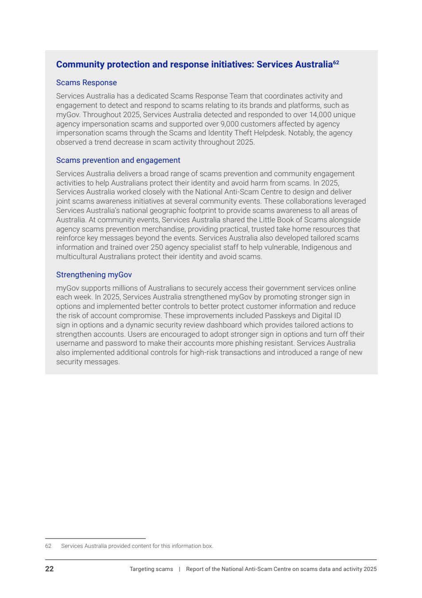

</details>

<!-- page 26 -->
## PDF page 26

### National media campaign

The ‘Stop. Check. Protect.’ campaign was active from 12 January to 22 March 2025.

The ‘Stop. Check. Protect.’ messaging was developed, launched and used in the campaign to drive
long term behavioural change amongst Australians, now and in the years to come.

The campaign successfully enhanced community understanding of scammer behaviours and
self-protective actions. Post-campaign research showed that people who saw the campaign
were more likely to have higher knowledge and understanding of scams, more positive attitudes,
higher awareness and understanding of Scamwatch and more likely to take protective actions
against scams.

ƒ Television advertising was divided into 2 bursts. Each reached over 3 million Australians in metro
markets and over 1 million in regional markets, surpassing planned targets.

ƒ Meta (Facebook and Instagram) activity delivered strong, cost-efficient results across
mainstream, First Nations, and CALD audiences. Over 7 million ThruPlays (played in entirety or for
at least 15 seconds) were achieved.

ƒ Over 2.7 million views on Xiaohongshu and WeChat aimed at Mandarin-speaking audiences.

ƒ Search advertising generated 58,787 clicks through to scamwatch.gov.au.

Consumer research shows that Australians are often overwhelmed by the conflicting advice and need
clear and consistent advice from Government on how to protect themselves from scams.63

To improve consistency, the National Anti-Scam Centre also delivered a communications guide to
government stakeholders centred on the unifying call to action ‘Stop. Check. Protect.’ The guide
reframes the language around scams and highlights the need to avoid victim-blaming and reaffirm
that scammers are serious criminals.

63 Consumer research includes non-published research to support the National Anti-scam Centre and Scamwatch brand
development and campaign research supporting the ‘Stop. Check. Protect.’ national campaign.

<details>
<summary>PDF page 26: original layout / charts</summary>

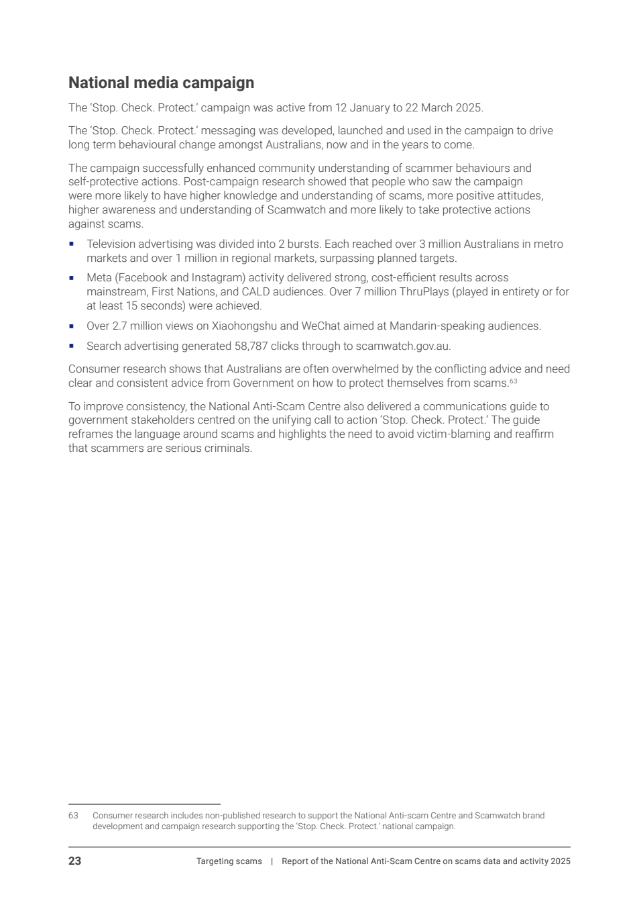

</details>

<!-- page 27 -->
## PDF page 27

### National media campaign highlights64656667

### 119%

increase in traffic to
Scamwatch.gov.au
homepage64

Over

### 2.7 million

views on channels aimed at
Mandarin speaking audiences65

### 6.8 million

impressions of CALD
media coverage66

### 4

Reached over

### million

Australians in each burst
of TV advertising67

Above: First Nations Little Book of Scams and ‘Stop. Check. Protect.’ poster.

64 From campaign launch on 12 Jan 2025 to 30 Jun 2025, there were 900,048 views, equivalent to an increase in traffic of
119% from the same period in 2024.
65 The campaign invested in Xiaohongshu (XHS) and WeChat advertorials to target Mandarin-speaking audiences aged 18–45.
The performance of all creative executions exceeded benchmarks and generated over 2.7 million views.
66 Approximate views of coverage by culturally and linguistically diverse media outlets.
67 People reached across metropolitan and regional markets through television advertising. Two bursts were conducted.

<details>
<summary>PDF page 27: original layout / charts</summary>

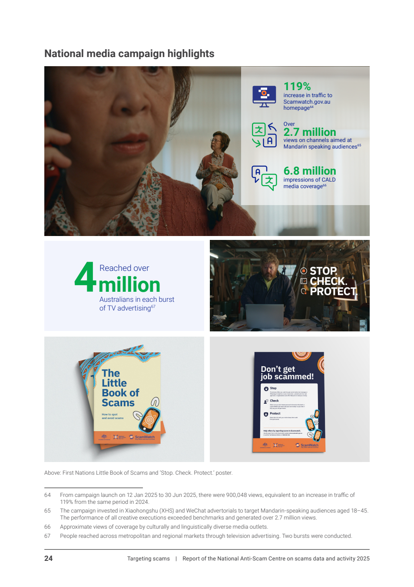

</details>

<!-- page 28 -->
## PDF page 28

### Scams Awareness Week

Scams Awareness Week 2025 ran from 25–29 August and aimed to raise community awareness of
the ’Stop. Check. Protect.’ messaging framework introduced in the national media campaign.

Four short videos were produced to share the real stories of Australian scam victims. These were
used in advertising and distributed to over 600 stakeholders to share with their audiences and spread
the messaging. Other outcomes included:

ƒ Over 900 media mentions, with an estimated audience reach of over 25 million.

ƒ Over 140 social media posts by industry, government and community tagged ‘Scamwatch’ during
the week. Many of these were highly creative and used the ‘Stop. Check. Protect.’ framework.

ƒ Representatives from sixteen organisations joined ACCC senior leaders and posted 23 short
videos throughout the week to offer ‘Scams Tips with the Pros’ to their own audiences.

ƒ Meta ads reached almost 1 million people and TikTok ads reached 347,882 people.

ƒ Scams awareness presentations were delivered to staff of Woolworths, Suncorp and the
Commonwealth Department of Public Prosecutions, as well as a community event organised by
Neighbourhood Watch.

Scams Awareness Week

### 25m+ 1,196

25–29 August:
‘Stop. Check. Protect.’ estimated engagements on organic
audience reach# social media posts*

#Cumulative reach from media coverage.
*Shares, comments and reactions generated by Scams Awareness Week on Meta and LinkedIn.

### Family and friends campaign

The National Anti-Scam Centre developed new Scamwatch guidance for family and friends to
support and assist their loved ones affected by scams.68 This guidance offers practical strategies
for recognising signs of scammer manipulation, approaching conversations with care, and providing
effective and compassionate support.

In 2025 consumer education played an important role in protecting Australians from scams. Equally,
consumer research and advocacy elevated consumer voices and perspectives to inform anti-scam
efforts. The National Anti-Scam Centre invited AUSTRAC and CHOICE to highlight important
consumer awareness initiatives in 2025.69 Their contributions are set out below.

68 More information can be found on the Scamwatch website at Help someone who’s being scammed.
69 CHOICE is a leading advocacy group, see https://www.choice.com.au (accessed 14 January 2026).

### Links on this page

- [https://www.scamwatch.gov.au/stop-check-protect/help-someone-whos-being-scammed](https://www.scamwatch.gov.au/stop-check-protect/help-someone-whos-being-scammed)
- [https://www.choice.com.au](https://www.choice.com.au)

<details>
<summary>PDF page 28: original layout / charts</summary>

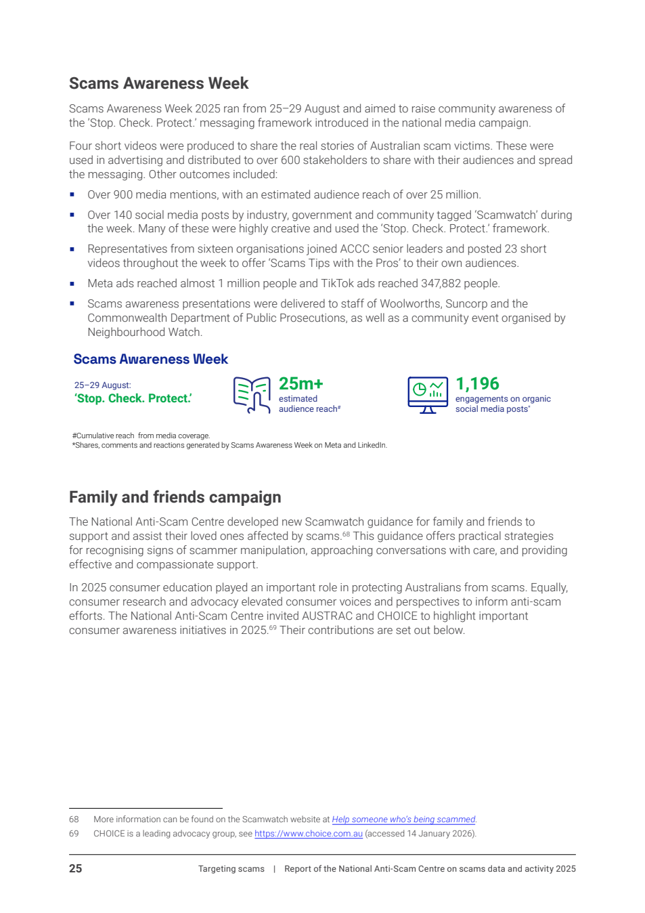

</details>

<!-- page 29 -->
## PDF page 29

### Consumer awareness initiative: Australian Transaction Reports and

### Analysis Centre (AUSTRAC)70

Strengthening community resilience to gambling scams

Throughout the year, the AUSTRAC-led Fintel Alliance71 commenced targeted work to address
the growing threat of micro-laundering and illegal online gambling in Australia.72

Although the Interactive Gambling Act 2001 (Cth) prohibits the provision of online casino-style
services to Australians,73 many unlicensed platforms continue to operate unlawfully. These
services are increasingly promoted through aggressive digital advertising, often targeting
individuals through social media feeds and private messaging groups.

A concerning trend emerging from this analysis is ‘scambling’, slang for online gambling
platforms that trick people into visiting scam websites to participate in gambling. This practice
is driving substantial financial harm in First Nations communities, especially in regional and
remote areas that may have limited access to support services or trusted information sources.

To counter this threat, Fintel Alliance partners developed a national awareness initiative
focused on reducing harm and empowering communities to recognise illegal gambling
schemes. Central to this effort is the Have You Been Scambled? educational package, which
provides clear guidance on how illegal gambling websites operate, the dangers of scambling,
and the warning signs that an online gambling offer is fraudulent.

Leveraging the strength of the Fintel Alliance public-private partnership, campaign material
was developed in collaboration with First Nations advocacy groups, banks, Indigenous
engagement teams, gambling regulators, and law enforcement agencies and distributed across
a broad network. This multichannel dissemination ensured that information reached affected
communities in culturally informed, accessible, and trusted formats.

The initiative not only raises awareness among at-risk groups but also supports financial
institutions to better identify and report both victims and suspected offenders involved in
illegal gambling-related micro-laundering. By improving detection practices and increasing
community understanding, Fintel Alliance is helping reduce harm, disrupt illegal operators, and
protect Australians from the expanding risks associated with unlawful online gambling.

70 AUSTRAC provided content for this information box.
71 The Fintel Alliance is an AUSTRAC initiative established in 2017 which brings together experts from a range of organisations
involved in the fight against money laundering, terrorism financing and other serious crime, Fintel Alliance | AUSTRAC
72 Micro-laundering is a method where criminal proceeds are broken into many small, low-value transactions to evade
detection, has become a key enabler of unlawful online gambling networks.
These offshore operators frequently exploit vulnerable Australians by using deceptive online advertising, anonymous
payment methods, and fastmoving social media promotion to mask their illegitimate activities.
73 The Interactive Gambling Act 2001 (Cth) is administered by the Australian Communications and Media Authority.

### Links on this page

- [https://www.austrac.gov.au/partners/fintel-alliance#:~:text=These educational materials are available here%3A](https://www.austrac.gov.au/partners/fintel-alliance#:~:text=These educational materials are available here%3A)
- [https://www.austrac.gov.au/partners/fintel-alliance](https://www.austrac.gov.au/partners/fintel-alliance)

<details>
<summary>PDF page 29: original layout / charts</summary>

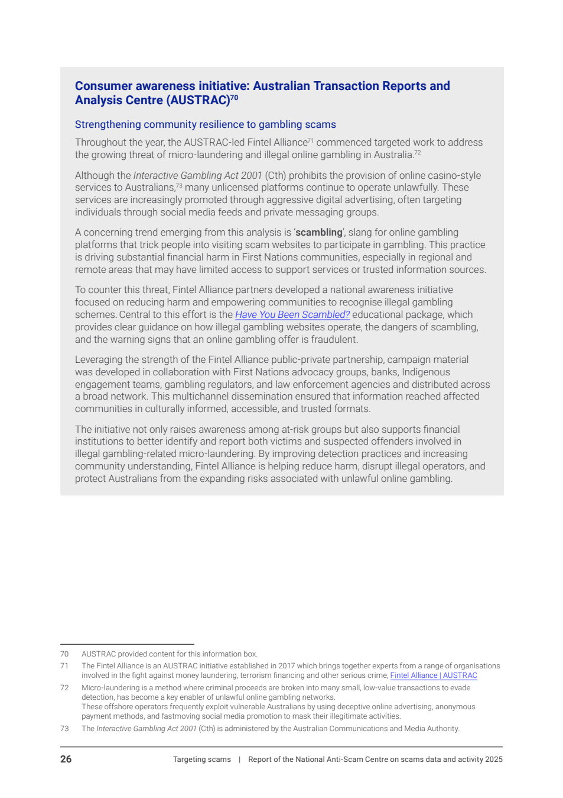

</details>

<!-- page 30 -->
## PDF page 30

### Consumer awareness initiative: CHOICE74

In 2025, CHOICE advocated for stronger scam protections for consumers, including through
representing the Consumers’ Federation of Australia on the National Anti-Scam Centre
Advisory Board, and through original research and consumer advocacy.

Over 4,000 CHOICE supporters emailed their Member of Parliament to support the passage
of the Scams Prevention Framework through Parliament, and CHOICE continues to engage
in consultations on operationalising the Framework through designation of sectors and the
development of industry codes.

CHOICE continues to provide consumer advice on how to detect scams and advice for victims,
from ghost stores to AI-assisted impersonation scams. Website content on scams attracted
approximately 69,000 views from around 48,000 users in 2025.

### Victim support

### Victim referrals and responses

In 2025 the National Anti-Scam Centre (through a data sharing arrangement) referred
8,536 Scamwatch reporters to IDCARE for tailored and timely scam recovery support.75 The National
Anti-Scam Centre also engaged with over 2,700 scam victims via emails and phone calls; double the
number of direct support engagement in 2024.

In providing this support, the National Anti-Scam Centre recognises the impact on scam victims
often goes well beyond financial loss and can inflict devastating emotional harm. Many Australians
have experienced significant harm to their mental health after experiencing financial crime.
Victims of scams may be referred to crisis support services such as Lifeline – 13 11 14 and
Beyond Blue – 1300 22 4636. In many cases these victims need ongoing mental health support to
recover. The National Anti-Scam Centre also refers victims to make a police report where they have
not done so.

### Support for scam victims

### 8,536 2,700+

referrals tailored victim
to IDCARE support responses

74 CHOICE provided content for this information box.
75 Reporters who opt-in to the referral process are contacted by IDCARE after submitting their Scamwatch report. IDCARE
offers advice and directions on how the victim can recover from the scam, and how they can protect themselves from
scams in future.

<details>
<summary>PDF page 30: original layout / charts</summary>

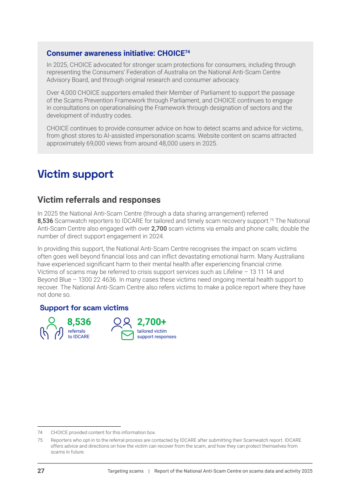

</details>

<!-- page 31 -->
## PDF page 31

In 2025, victim support and consumer advocacy organisations played an important role in helping
scam victims recover, both financially and emotionally, from the impact of scams, and ensuring
victims’ voices are heard in the development of the Scams Prevention Framework. The National
Anti-Scam Centre invited the Consumer Action Law Centre to describe key initiatives in 2025.76 Their
content is set out below.

### Victim Support and Consumer Advocacy: Consumer Action Law Centre77

Scam Campaign Activities in 2025

In 2025, Consumer Action Law Centre (Consumer Action) continued to see a steady flow of
people seeking help after losing money to increasingly complex scams. The year was marked
by clients reporting significant financial loss, emotional distress, and prolonged uncertainty
while trying to navigate slow or inconsistent responses from their banks and other service
providers. Many callers to the National Debt Helpline and the Consumer Action legal advice line
were dealing not only with the immediate shock of losing money but also the wider impacts on
their families, mental health, and financial stability. This ongoing client work remained central to
shaping Consumer Action’s advocacy.

A major focus in 2025 was the development and implementation of the Federal Government’s
Scams Prevention Framework. Consumer Action continues to contribute detailed submissions,
technical feedback and policy analysis as it takes shape. Consumer Action also continues to
raise systemic issues with ASIC, ACCC and Australian Financial Complaints Authority (AFCA)
based on recurring patterns in client stories, including delays in scam detection, inadequate
warnings, and inconsistent decisions about refunds.

In the final 3 months of 2025, callers to Consumer Action’s frontline services alone reported
$7.1 million lost, with 78% of victims who reported a loss living with at least one pre-existing
vulnerability — and one in 3 living with 3 or more. In addition, 32% of victims who reported a
loss said they were being held liable by banks or lenders for ongoing debts associated with the
scam, and 28% reported scam-related ATO debt.78

Across 2025, Consumer Action’s advocacy remained grounded in what clients were
experiencing every day: a system struggling to keep pace with scams and a deep need for
appropriate reforms.

76 The Consumer Action Law Centre is a campaign-focused consumer advocacy organisation, see https://consumeraction.
org.au/ (accessed 16 February 2025).
77 The Consumer Action Law Centre provided content for this information box.
78 Consumer Action Law Centre, ‘Ongoing and significant harms’: New data shows millions still lost to scams in late 2025 [media
release], Consumer Action Law Centre, 29 January 2026, accessed 23 February 2026.

### Links on this page

- [https://consumeraction.org.au/](https://consumeraction.org.au/)
- [https://consumeraction.org.au/ongoing-and-significant-harms-new-data-shows-millions-still-lost-to-scams-in-late-2025/](https://consumeraction.org.au/ongoing-and-significant-harms-new-data-shows-millions-still-lost-to-scams-in-late-2025/)

<details>
<summary>PDF page 31: original layout / charts</summary>

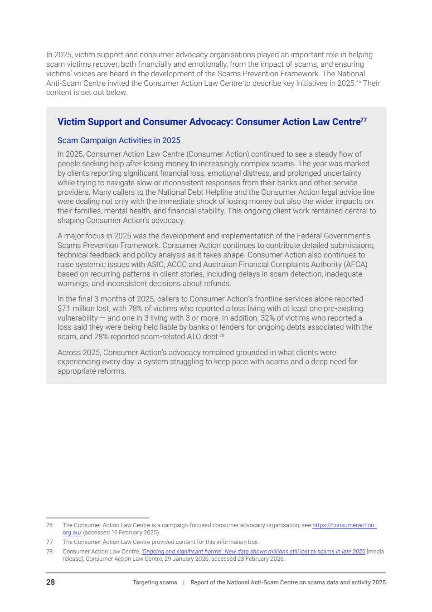

</details>

<!-- page 32 -->
## PDF page 32

### Looking forward

### Scams Prevention Framework: The Treasury79

The Government is implementing the Scams Prevention Framework, including sector codes
and rules, as quickly as possible, working closely across government and with regulators,
AFCA, consumer groups and industry. This world-leading, prevention-first framework
strengthens industry obligations, improves dispute resolution and intelligence sharing, and is
focused on reducing scam harms for the Australian community.

In 2026 the National Anti-Scam Centre will continue to ensure that technology is enabling data
sharing for regulated entities to share data under the Framework as well as voluntary sharing for
those entities not regulated under the Framework.80 The National Anti-Scam Centre will continue
to advocate for businesses to use the data sharing technology (i.e., parter portal and APIs) on a
voluntary basis, and contribute to code development. We will also continue to work with existing data
partners to maximise the accuracy and completeness of the aggregated picture of the scam impact
in Australia.

The ACCC will continue working closely with the ACMA and the ASIC as sector regulators for
telecommunication providers and banks respectively to manage enforcement and compliance. The
ACCC will also develop a compliance and enforcement strategy and publish guidance for industry in
due course.

International interest in the National Anti-Scam Centre and the Scams Prevention Framework has
grown significantly and is anticipated to increase.

As a member of the Global Anti-Scam Alliance Advisory Board, the National Anti-Scam Centre will
continue to work with GASA’s international members in a globally coordinated and united manner.
This includes attending the Global Anti-Scam Summit taking place in Lisbon in June 2026.81

The National Anti-Scam Centre will continue community outreach activities, including by expanding
the program with law enforcement and a small number of government agencies. The program seeks
to upskill trusted third parties to deliver scam awareness sessions to vulnerable audiences.

Supporting those living with disability, the National Anti-Scam Centre has partnered with Monash
University’s Cyberability Project,82 which will develop support strategies and resources to help people
with cognitive disability, such as brain injury, intellectual disability, or dementia, avoid and recover
from online scams. The project aims to strengthen frontline responses for cyber scam victims,
conduct a national trial of a co-designed support program for victims, and distribute free education
material nationwide, empowering people with disability to participate more securely online.

The ‘Stop. Check. Protect.’ message remains central to public awareness campaigns, encouraging
individuals to pause before acting, verify legitimacy and report scams promptly. The National
Anti-Scam Centre will continue to drive behaviour change through ‘Stop. Check. Protect.’ as well as
Scams Awareness Week which will again take place in August 2026.

After the success of the previous 3 Fusion cells, the National Anti-Scam Centre will once again be
working with a broad range of stakeholders on its fourth time-limited taskforce expected to kick off
by June 2026.

79 The Treasury provided content for this information box.
80 Our continued focus for 2026 includes prioritising working with industries to be regulated under the Scams Prevention
Framework, namely banking, digital platforms and telecommunications providers.
81 GASA, Global Anti-Scam Summit Europe 2026, GASA events website, n.d., accessed 24 February 2026.
82 Monash University, The CYBERABILITY Project, Cyberability website, 2025, accessed 16 March 2026.

### Links on this page

- [https://events.gasa.org/gass-europe-2026](https://events.gasa.org/gass-europe-2026)
- [https://www.cyberability.org.au/](https://www.cyberability.org.au/)

<details>
<summary>PDF page 32: original layout / charts</summary>

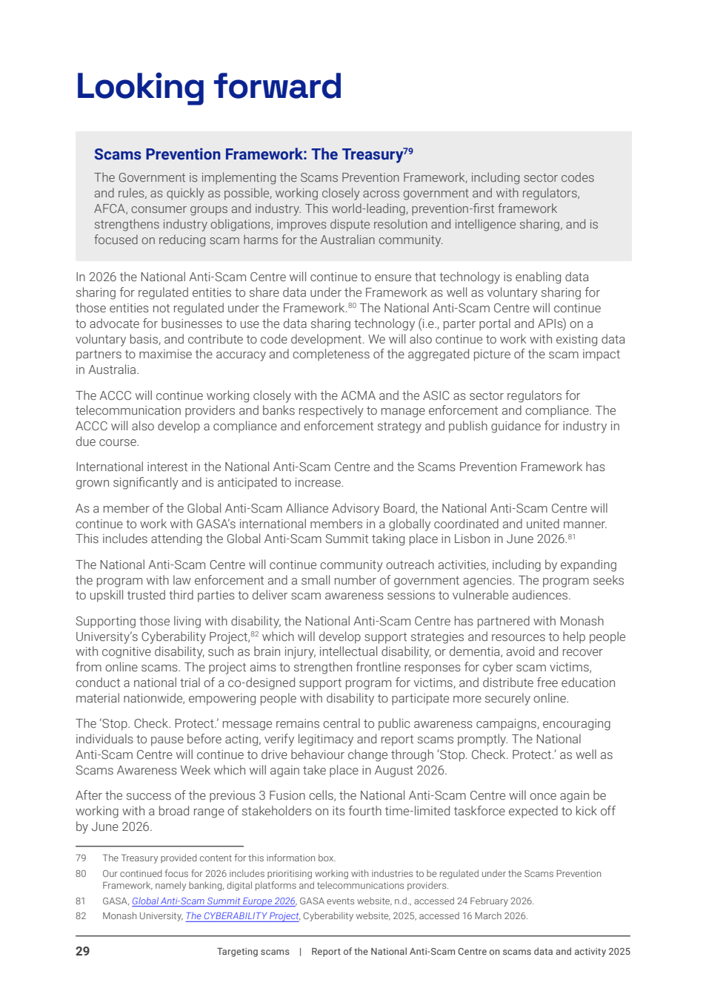

</details>

<!-- page 33 -->
## PDF page 33

### Appendix 1 – Scamwatch data

### and observations

All data presented in Appendix 1 relates to reports submitted to Scamwatch only.

### Report and loss statistics

Scamwatch is a detailed data source that includes information about scam types, people affected,
communication and payment methods used by scammers, and information about the backgrounds
of reporters and victims. This data enables further exploration of trends in scam categories, methods,
and impacted communities. Importantly, around 85.9% of reports to Scamwatch are from people who
have not suffered a financial loss.

Scamwatch data is a subset of total combined losses reported to Scamwatch, ReportCyber, AFCX,
IDCARE and ASIC, so caution should be exercised in making definitive statements about total
losses and trends based upon Scamwatch data alone. Of the various data sources in this Report, in
2025 Scamwatch data comprised 39.2% of all reports and 12.8% of all loss.

Scamwatch received 200,675 reports in 2025, a 19.6% decrease compared with 2024. Over
28,200 reports (approximately 14.1%) included a financial loss in 2025, compared to 9.0% in
2024. Financial losses reported to Scamwatch increased by 5.0% compared with 2024, rising
from $318.8 million in 2024 to $334.8 million in 2025. The Scamwatch median loss decreased by
20.0% from $500 in 2024 to $400 in 2025.

The National Anti-Scam Centre observed changes in patterns of scam reporting and financial harm
in Scamwatch data in 2025. While scam reports decreased in 2025, the data shows that there have
been increases in reporting for some scam types:

ƒ Job and employment scam reports increased by 102.4%.

ƒ Betting and sports investment scam reports increased by 19.6%.

ƒ Identity theft reports increased by 13.1%.

### Increased reporting of Job scams by young and vulnerable

### Australians

The National Anti-Scam Centre’s monthly reports of job scams to Scamwatch peaked in June 2025
and decreased through to December. The key drivers of the increased job scam reports were:

ƒ increases in reports through text message and online contact methods

ƒ almost 1,200 reports by young people aged 25–34, a 102.5% increase

ƒ increased reporting from at risk communities including:

– 76.3% in reports from First Nations people

– 114.0% increase from people with disability

– 51.4% increase from CALD communities.

Overwhelmingly, online contact methods for job scams led to the most significant financial harm.
Three times as many people reported a financial loss where contact was online, compared to other
contact methods, and over $19 million was reported lost to online job scams overall.

<details>
<summary>PDF page 33: original layout / charts</summary>

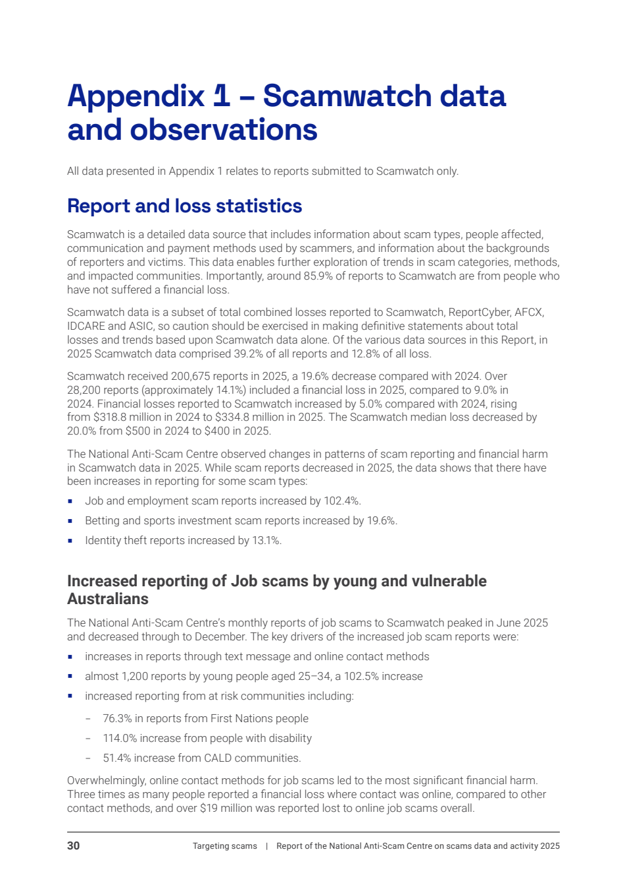

</details>

<!-- page 34 -->
## PDF page 34

The National Anti-Scam Centre Job Scam Fusion Cell was completed in May 2025 and included
targeted awareness raising for at risk communities. This may have contributed to increases in
reporting. However, the level of reports and financial loss continuing through 2025 suggests that
more work is required particularly by digital platforms to combat these scams.

### Increasing harm from Betting scams reported by at risk

### communities

There was a 91.5% increase in reports about betting scams from First Nations people and a
93.5% increase in reports from people with disability. Similarly, the level of harm appears to be
increasing, with loss reports from First Nations people increasing by 88.9% and threefold for
people with disability. While increased awareness about scams may drive more reporting, there
remains low levels of reports from more remote communities and a likelihood that these scams are
underreported.83

For people with disability there was over 2,000% increase in financial loss and median losses
increased 66.7% to $1,000, which was well above all scams. Most people who lost money were
contacted online.

### Identify theft reporting by CALD communities

There was a 13.7% increase in reports about identity theft scams from CALD communities. This
may be a sign that increased awareness raising by the National Anti-Scam Centre including through
the ‘Stop. Check. Protect.’ campaign focus on CALD communities is having an impact. However, it
is also likely that the services and platforms that CALD communities use are increasingly targeted
by scammers. The number of people from CALD communities reporting loss through identity
theft scams almost doubled in 2025. Over half of the people who lost money reported an online
contact method.

### Scammer contact methods are changing

Scamwatch data highlights some changes in contact methods which is further described in the
Contact methods section below, including:

ƒ Scammers have less success using phone calls as a contact method. In 2025, reports decreased
by 9.0%, losses decreased by 32.4% and reports with loss also decreased by 7.7%.

ƒ Scammers are more successful using websites, digital and social media platforms to steal money
from Australians. In 2025, reports increased 28.8%; losses increased 21.8% and the reported
contact method leading to financial loss was through online contact methods.84

ƒ The largest decrease in reports was for text message scams, down from 77,365 in 2024 to
29,058 in 2025, but overall financial loss for text scams was higher than in 2024.

83 Reports from First Nations people were highest for Victoria and New South Wales.
84 ‘Online’ as a contact method includes previous categories: ‘internet’, ‘mobile apps’ and ‘social media/online forums’.

<details>
<summary>PDF page 34: original layout / charts</summary>

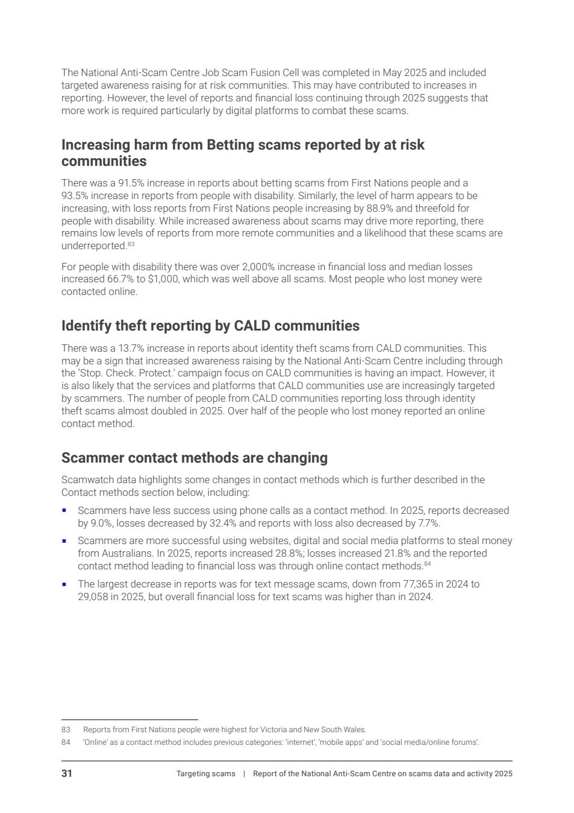

</details>

<!-- page 35 -->
## PDF page 35

### Losses reported to Scamwatch

Figure 1: Losses and reports with loss by month 2024 – 2025

$40.0 3,000

$35.0
2,500

$30.0
)noillim
2,000
ssol
$25.0
htiw
$(
$20.0 1,500
ssol
stropeR
laicnaniF
$15.0
1,000

$10.0

500
$5.0

$0 0
Jan Feb Mar Apr May Jun Jul Aug Sep Oct Nov Dec Jan Feb Mar Apr May Jun Jul Aug Sep Oct Nov Dec
2024 2025

Financial loss Reports with loss

The National Anti-Scam Centre has observed that there may be several factors contributing to the
decrease in reporting between 2024 and 2025 including:

ƒ An increase in the sophistication of scams, including the use of artificial intelligence, making it
harder for consumers to recognise significant scams and report them. This is why the National
Anti-Scam Centre continues to collect and share data and intelligence across the scams
ecosystem, which informs public scam alerts and other awareness-raising activities.

ƒ An increase in the promotion of a variety of reporting channels including direct to specific
businesses in the ecosystem. Organisations such as the National Anti-Scam Centre routinely
include IDCARE’s phone number and information on our consumer and victim information.

ƒ A decrease in consumers coming in to contact with scams possibly due to scam prevention
initiatives such as improved call and SMS blocking, phishing filters and fraud monitoring.

ƒ The potential for report fatigue highlights the need for our continued focus on user experience
for consumers reporting through Scamwatch. At the same time, underreporting, likely remains
an issue.

<details>
<summary>PDF page 35: original layout / charts</summary>

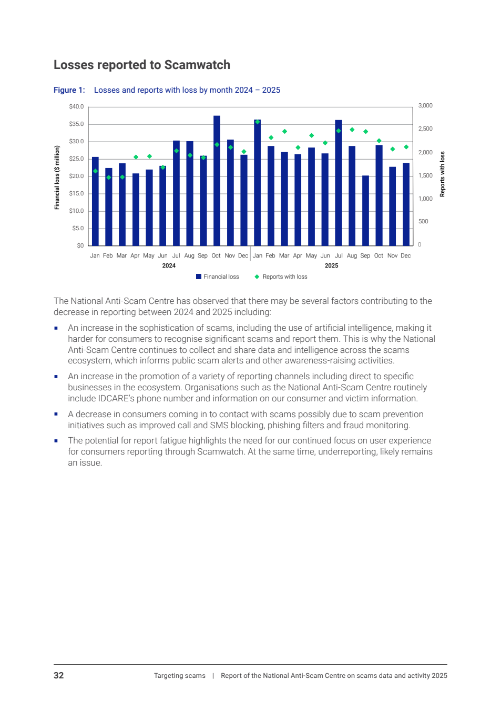

</details>

<!-- page 36 -->
## PDF page 36

Figure 2: Number of reports in 2024 – 2025 by month, where losses per report were $50k or higher

$35.0 140

$30.0 120

$25.0 100
)noillim
ssol
$20.0 80
htiw
$(
ssol
stropeR
$15.0 60
laicnaniF
$10.0 40

$5.0 20

$0 0

Jan Feb Mar Apr May Jun Jul Aug Sep Oct Nov Dec Jan Feb Mar Apr May Jun Jul Aug Sep Oct Nov Dec
2024 2025

Financial loss Reports with loss

The monthly reports with losses over $50,000 were consistent throughout 2025. The exception being
January and July which appear to peak due to a small number of reports with substantially high
losses. These high value losses have been verified.

### Scam categories reported to Scamwatch

The most reported scams in 2025 were phishing scams. Scamwatch received 65,361 reports about
phishing scams, a decrease of 33.2% compared to 2024. Despite being the most reported scam only
2.3% of people reporting phishing scams reported a financial loss.

More Australians reported a financial loss to shopping scams compared to any other scam type
in 2025 as observed in Scamwatch data.85 There were 12,248 Australians who reported a loss to
shopping scams, reporting total overall losses of $10.8 million in 2025. This is a 22.2% increase from
the 10,022 who reported financial loss to shopping scams in 2024.

85 Shopping scams includes the Scamwatch categories: online shopping scams and classified scams.

<details>
<summary>PDF page 36: original layout / charts</summary>

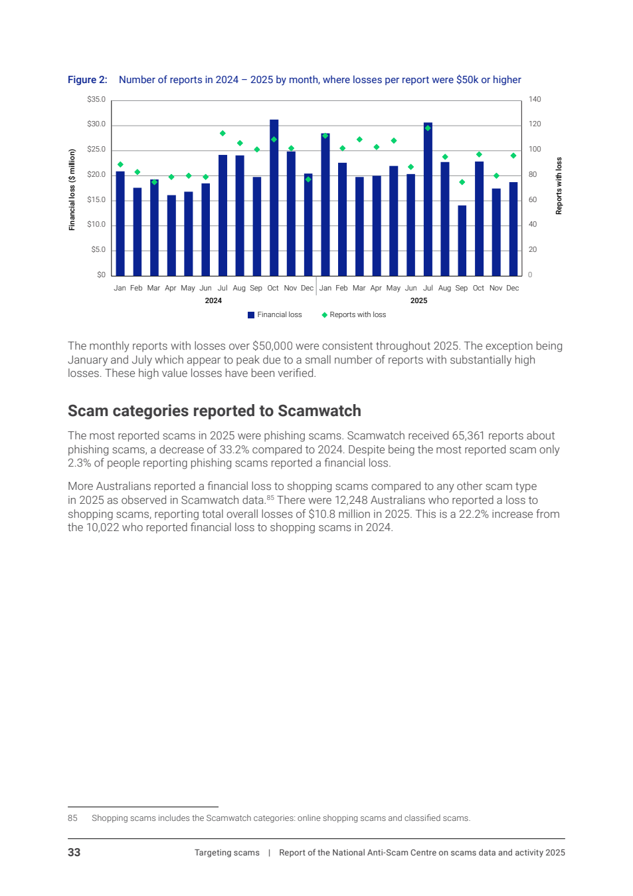

</details>

<!-- page 37 -->
## PDF page 37

Figure 3: Top scam categories by reports with loss

Shopping scams

Investment scams

False billing scams

Other scams

Jobs and employment scams

0k 2k 4k 6k 8k 10k 12k 14k

Reports with loss 2024 Reports with loss 2025

Figure 4: Top scam categories by overall loss

Investment scams

Phishing scams

Dating and romance scams

Jobs and employment scams

False billing scams

$0m $50m $100m $150m $200m

Total loss 2024 Total loss 2025

Investment scams led to the highest overall losses ($172.2 million), although the amount lost
decreased by 10.5% compared with 2024. All other scam categories in the top 5 losses increased
in 2025 compared to 2024. The top 5 scam categories by loss accounted for 83.7% of the total
loss reported to Scamwatch in 2025. Australians often report significant individual financial loss in
categories such as Investment scams and Romance scams and this will often include loss from
retirement savings and superannuation.

There was an 81.5% increase in reported losses for Jobs and employment scams with reports
increasing 102.5% on 2024 volumes. Losses to this scam type jumped from $13.7 million in 2024 to
$24.8 million in 2025.

Reports of Remote access scams reduced 47.8% in 2025 also reflecting a 37.2% decline in losses
from $7.5 million to $4.7 million. The reduction may be attributed to the detection and disruption
efforts of banks and the telecommunications sector.

<details>
<summary>PDF page 37: original layout / charts</summary>

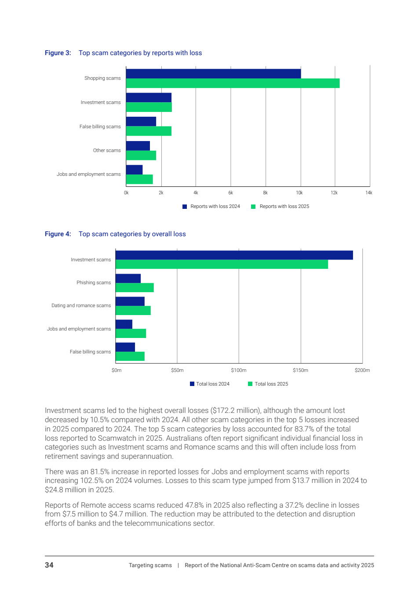

</details>

<!-- page 38 -->
## PDF page 38

Rebate scams have seen a 49.1% reduction in reports however losses have risen by 170.0% from
$1.7 million to $4.7 million. This increase has been associated with several reports of high value
cryptocurrency recovery scams.

Scams involving betting and sports investment have seen a 280.0% increase in losses in 2025
resulting in $2.4 million lost, mostly impacting those in the age groups of 25–34 and 35–44.86

### Contact methods reported to Scamwatch

The most frequently reported contact method in 2025 was email (84,861 reports), however only
4,329 people (5.0%) reported losing money when contacted this way.

The most reported contact method leading to financial loss was through online contact
methods.87 There were 19,169 reports about online scams with financial loss in 2025, compared to
14,543 reported in 2024 representing a 31.8% increase. Losses from online scams increased 21.8% in
2025 to $158.5 million (from $130.1 million in 2024), with the median loss being $400.

The contact method that saw the largest decrease in financial loss was phone calls, with losses
decreasing by 32.0% from $107.2 million to $72.5 million. This contact method also had the largest
decrease in reports with loss decreasing by 7.7% (2,179 reports with loss in 2024 to 2,012 reports with
loss in 2025). However, Scamwatch data suggests that phone scams tend to lead to higher individual
losses, with a median loss of $3,800.

Scamwatch saw a significant reduction of 62.4% in the number of text message scams reported
from 77,365 in 2024 to 29,058 in 2025. This may indicate improved disruption action across the
ecosystem. Overall losses via this method however continued to rise from $14.0 million in 2024
to $17.9 million with several high value losses in the categories of jobs and employment scams,
investment scams and phishing.

Figure 5: Top contact methods by number of reports with loss

In person
Text message Mail
870
1,603 218

Phone call
2,012

Email
4,329

Online
,
19,169

86 Reporters aged 25–34 and 35–44 lost $1.8 million to betting and sports investment scams in 2025.
87 ‘Online’ as a contact method includes previous categories: ‘internet’, ‘mobile apps’ and ‘social media/online forums’.

<details>
<summary>PDF page 38: original layout / charts</summary>

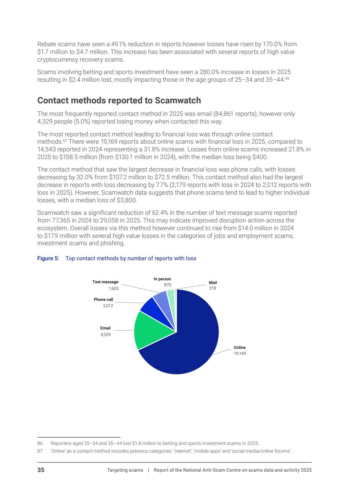

</details>

<!-- page 39 -->
## PDF page 39

Figure 6: Top contact methods by overall loss

Mail
Text message $2,738,406
$17,977,491
In person
$25,255,402

Email
$57,877,574 Online
$158,504,957

,

Phone call
$72,477,723

### Payment methods reported to Scamwatch

The highest overall losses in 2025 were made by cryptocurrency/DCE88 (3,993 transactions)89 which
accounted for 36.2% of overall losses with $121.3 million reported lost. This has been a significant
shift from bank transfers in 2024.

Bank transfers are still the highest requested method of payment by scammers with 8,858 reports
leading to losses of $118.1 million in 2025.

Figure 7: Top payment methods by number of reports

Other gift card
1k

Cryptocurrency/DCE
4k

Credit Card
8k

,
Bank transfer
Cash 9k
1k

88 Cryptocurrency and Digital Currency Exchange (DCE) is a single category, noting that consumers can send money to DCEs
via bank transfer. Bank transfer as a category reflects bank to bank scam transactions whereas Cryptocurrency/DCE reflects
bank to DCE and cryptocurrency only. This is consistent with previous NASC reports, and identifies more clearly the level of
scam transactions moving outside of traditional banks.
89 A Scamwatch report could have up to one non-crypto related payment and one crypto-related payment. Therefore, a report
could have more than one transaction payment type.

<details>
<summary>PDF page 39: original layout / charts</summary>

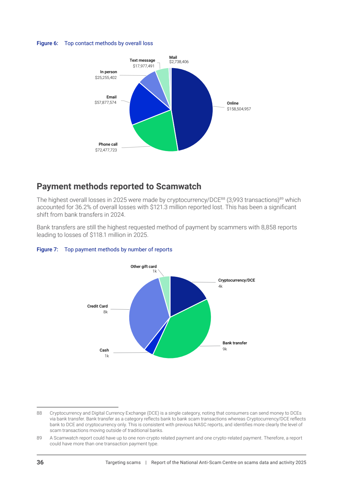

</details>

<!-- page 40 -->
## PDF page 40

Figure 8: Top payment methods by overall loss

Credit Card Other gift card
$9.1m $5.8m
Cash
$10.0m

Cryptocurrency/DCE
$121.3m

Bank transfer
$118.1m ,

### People and communities at increased risk of harm

### from scams

Anyone can experience a situation which may result in exposure to a scammer where their ability to
prevent financial loss or harm is limited. Education level, status, wealth, employment, age, health and
culture do not provide immunity from scams. Given the right set of circumstances, it can happen
to anyone.

However, some people and communities face significant barriers and circumstances that can
make them more vulnerable to a scam (for example, those experiencing inadequate housing,
financial constraints, poverty, food insecurity, or poor health). They may also be disadvantaged by
inequality and systems, which can lead to increased risk of harm from scams. Many communities
and demographics may face significant barriers to accessing information which could assist them
to avoid scams and may also find it difficult to report a scam. This can make it harder for them to
manage the effects of the scam including by seeking assistance.

While analysing Scamwatch data regarding communities at increased risk of harm from scams is
important, in some instances the data sample size is small relative to the complete Scamwatch
data; consequently, caution should be exercised when drawing conclusions from a relatively small
sample size.

### Reports to Scamwatch by people from First Nations communities

People identifying as First Nations reported fewer scams to Scamwatch in 2025 with 3,961 reports
compared to 4,254 in 2024.90 Of these, 904 reported a financial loss in 2025 compared to the 661 in
2024. The median loss in 2025 was $499, almost $100 higher than for all Scamwatch reporters.

Overall reported losses increased by 6.9% to $7 million (from $6.5 million in 2024). This increase was
largely driven by a greater number of high loss reports across First Nations reporters. In 2024, there
were 27 reports with losses of $50,000 or more, in 2025 this increased to 29.

Losses to Betting and sports investment scams increased 257.5% for First Nations communities
from $221,148 in 2024 to $790,685 in 2025. Losses to investment scams also continue to rise,

90 The Scamwatch form provides an optional field for reporters to specify if they are Indigenous.

<details>
<summary>PDF page 40: original layout / charts</summary>

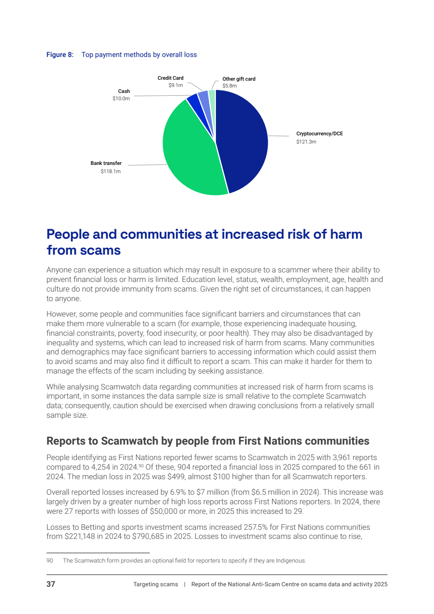

</details>

<!-- page 41 -->
## PDF page 41

increasing 162.7% from 2024 to $4.1 million. Notably there was a 72.8% decrease in the amount lost
to Dating and romance scams with losses dropping from $1.4 million in 2024 to $399, 220 in 2025.

Most First Nations people were contacted by a scammer via online channels or phone calls, which
together accounted for 68.9% of all contact methods, or 1,966 reports.

Given the relatively small numbers of reports from people identifying as First Nations and the
increasing number of high value losses it is difficult to draw trends from the data.

### Reports to Scamwatch by people from culturally and linguistically

### diverse (CALD) communities

People reporting to Scamwatch who identified as CALD made 10,065 Scamwatch reports in 2025.91
Of these, 2,282 people reported having money stolen totalling $38.9 million. This amount remains
consistent with 2024 losses at $38.8 million. The median loss of those who identified as CALD was
$750, 50.0% higher than the median of $400 for all Scamwatch reporters in 2025.

Table 4: Top 5 scams by loss reported by people from CALD communities in 2025

```text
                                                            % change in total loss
          Scam category  Reports with loss Total loss Median loss  from 2024
          Investment             321      $15.8m       $8.0k       -18.8% q

          Threat-based           68        $7.3m       $54.9k       -3.2% q
          Jobs and employment    230       $4.5m       $4.5k       119.8% p
          Romance                112       $4.2m       $2.0k        9.4% p

          False billing          201       $2.1m       $1.0k        59.6% p
```

While people from CALD communities reported losing more money to investment scams,
$15.8 million in 2025, threat-based scams had the highest median loss of around $55,000. People
from CALD communities made up 7.0% of people reporting threat-based scams but accounted
for 52.7% of losses for this scam type. This is primarily due to Chinese authority scams where
scammers impersonate overseas law enforcement or officials and threaten imprisonment or
deportation if money is not paid.

Job and employment scams are also on the rise within CALD communities as they are known to
target international students and non-resident visa holders.

### Reports to Scamwatch from people with disability

People with disability made 15,938 reports to Scamwatch in 2025. Of these, 1,962 people reported
losing money amounting to $18.8 million. This represents a decrease of 9.2% on the $20.8 million lost
in 2024.

The most common contact methods where people with disability lost money were online contact
modes, with 1,293 reports totalling $11.0 million, and phone scams with 146 reports totalling
$3.3 million.

People with a disability reported most losses to Dating and romance scams ($6.6 million) and
investment scams ($5.0 million).

91 The Scamwatch form provides an optional field for reporters to specify if they speak a Language other than English. It does
not ask what language or ask for information about reporters’ specific cultural background.

<details>
<summary>PDF page 41: original layout / charts</summary>

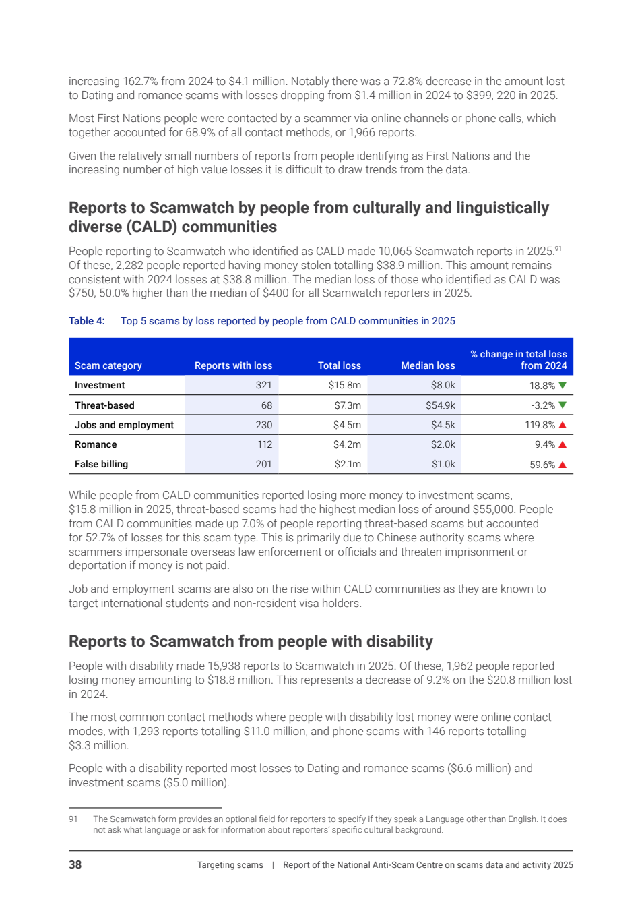

</details>

<!-- page 42 -->
## PDF page 42

Identity theft and Phishing scams continue to be in the top 5 scam loss categories in 2025 with
some people reporting the compromise of their government services and scammers changing where
payments were sent.

People with disability were more likely to lose money to shopping scams than any other scam type
with 637 reports with loss and overall losses of $632,259.92

Table 5: Top 5 scams by loss reported by people with a disability in 2025

```text
                                                            % change in total loss
          Scam category Reports with loss Total loss Median loss   from 2024
          Romance              227       $6.6m        $2.0k         36.8% p

          Investment           160       $5.0m        $3.5k        -32.5% q
          Identity theft       108       $1.3m        $1.0k        -33.9% q

          Phishing             110       $949k        $1.8k        -21.5% q
          False billing        168       $922k        $0.4k         14.5% p
```

### Scamwatch reports by Australians based on age

From 2024 to 2025, the number of reports and total loss amounts increased across all age groups
under 55. In contrast, the 55–64 and 65+ age groups reported fewer scams and had a lower total
loss compared to 2024.

People aged 65 and over reported the highest overall losses of $88.8 million, 26.5% of all losses
reported to Scamwatch, despite making up only 17.2% of the population.93 This represents a
10.9% decrease in reported losses from the $99.6 million reported lost by people aged 65 and over
in 2024.

People aged 65 and over had the highest median loss of any age group, $716, down from $1,000 in
2024, and were the most likely to report a scam in 2025 with 44,411 reports.

In terms of likelihood to experience a financial loss, people aged 35–44 reported the most with loss,94
5,037 reports with overall losses of $43.7 million.

There were significant differences in the scams leading to financial loss for different age groups.
For those aged 18–24 threat-based scams led to the highest aggregate losses.95 This may be due
to the large volume of sextortion scams,96 as well as authority scams targeting young migrants and
international students. The highest loss scam type for people in the 25–34 and 35–44 age groups
was investment scams, followed by jobs scams.

In older age groups, investment and romance scams led to the highest losses. People aged 55–64
reported $39.2 million in losses to Investment scams, 4.2% lower than 2024, and $7.1 million in losses
to Romance scams, 7.8% higher than 2024. Many Australians aged 65 and older may have access
to retirement savings and could be seeking investment opportunities, which may explain why people
in this age group reported total losses to investment scams of $50.8 million. While the amount lost

92 Shopping scams includes the Scamwatch categories: online shopping scams and classified scams.
93 According to census data people aged 65 and over make up 17.2% of the population.
94 According to census data people aged 35–44 make up 13.7% of the population.
95 According to census data people aged 20–24 make up 6.2% of the population.
96 Fake sextortion in this context refers to scam activity where the perpetrator threatens to release explicit images or video of a
victim if money is not paid, when in fact they do not have these images. Real sextortion is also known as image-based abuse
where the perpetrator has images or videos that they threaten to release if money is not paid.

<details>
<summary>PDF page 42: original layout / charts</summary>

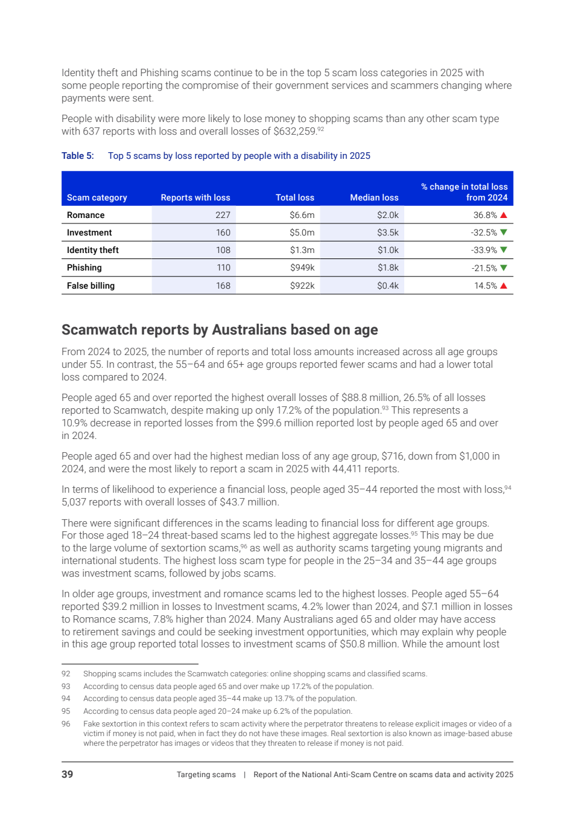

</details>

<!-- page 43 -->
## PDF page 43

remains concerning there has been consecutive annual reduction in losses to investment scams by
people 65 years and over (losses reduced 20.4% from 2023 to 2024 and 23.8% from 2024 to 2025).

Table 6: Top 2 scam types by overall loss for age groups in 2025

```text
          Age group   Highest loss scam Losses 2nd highest loss scam Losses
                      type                   type
          Under 18 years Shopping97    $926,636 Investment          $56,469
          18–24 years Threat-based      $8.2m Job                    $2.2m

          25–34 years Investment        $10.8m Job                   $5.9m
          35–44 years Investment        $17.9m Job                   $6.3m
          45–54 years Investment        $33.2m False billing         $5.8m

          55–64 years Investment        $39.2m Romance               $7.1m
          65 and over Investment        $50.8m Phishing             $12.5m

          Unspecified Investment        $18.5m False billing         $6.4m
```

Figure 9: Scam reports with losses by age group

$100m 6,000

$90m
5,000
$80m

$70m
ssol
4,000
)noillim
$60m
htiw
$(
stroper
$50m 3,000
ssol
$40m
latoT
latoT
2,000
$30m

$20m
1,000
$10m

$0m 0
Under 18 18–24 25–34 35–44 45–54 55–64 65 and over Unspecified

Total loss Reports with loss

### Scamwatch reports from small business

Small businesses are targeted by scammers through a variety of methodologies,98 including phishing
attempts and fake invoices. Small businesses lodged 2,228 reports to Scamwatch in 2025, with
287 reporting financial loss amounting to $9.5 million, 27.9% lower than 2024.

The reduction in reports does not necessarily mean a reduction in harm. Small businesses have
access to a wide range of scam and cyber reporting channels, enabling them to seek timely support
from the appropriate authorities.

97 Shopping scams includes the Scamwatch categories: online shopping scams and classified scams.
98 Small business includes reports from small (5 to 19 employees) and micro businesses (0–4 employees).

<details>
<summary>PDF page 43: original layout / charts</summary>

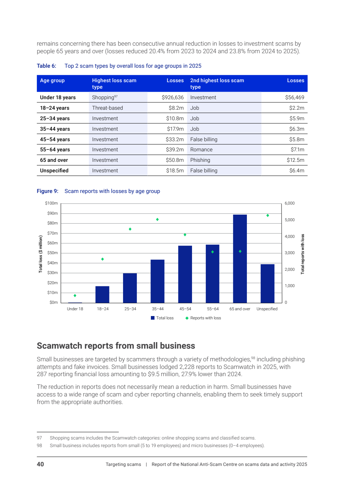

</details>

<!-- page 44 -->
## PDF page 44

Small businesses reported the highest overall loss to investment scams, $6.2 million representing a
decrease of 27.6% from 2024. False billing was the most reported scam type both with and without
financial loss. False billing reports from business generally relate to ‘payment redirections’ also known
as ‘business email compromise’ scams. Small businesses reported more scams, more scam reports
with loss and higher aggregate loss than medium and large businesses.

Figure 10: Top 5 scams by financial loss reported by small business

Shopping scams Identity theft
$0.4m $0.2m
Phishing
$0.6m

False billing
$2.0m

Investment scams
,
$6.2m

<details>
<summary>PDF page 44: original layout / charts</summary>

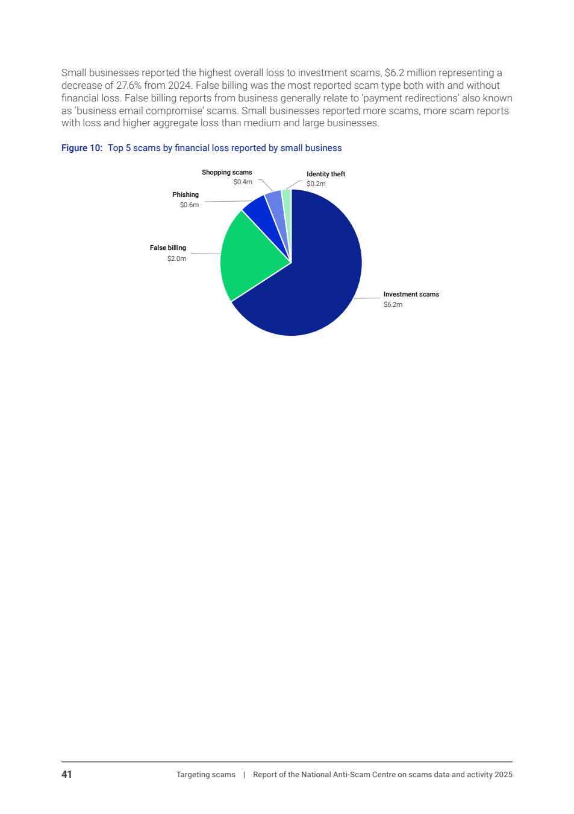

</details>

<!-- page 45 -->
## PDF page 45

### Appendix 2 – About the data used

### in this report

The data in this report is for the period 1 January to 31 December 2025. It includes 5 data sources:
Scamwatch, ReportCyber, the AFCX, IDCARE, and ASIC.

In many cases there can be overlap in the scams reported to these organisations, for example, by the
same scam being reported by the same person to several of the entities that record scam activity. To
the extent possible, such overlaps between datasets have been identified and duplication removed,
with a separate ‘adjustments row’ included to account for this in the totals reported throughout this
report. Further information on the approach used to identify the extent of the overlap between the
datasets is set out below.

There have been some changes between 2024 and 2025 that impact the methodology used to
combine data in this report, this includes:

ƒ The AFCX now maintains confidentiality over which banks and organisations are contributing data
to its platform. This means that it is not possible to account for increases or decreases caused
by changes in data contributors or to include explanations about changes as have appeared
in footnotes in previous reports. It also impacts the processes used to identify duplicates in
the data. Like many organisations, the AFCX provides de-identified data and prior to 2025, the
National Anti-Scam Centre would use the list of contributing AFCX entities to remove duplicates
from data sources such as IDCARE.

ƒ The National Anti-Scam Centre changed its quality assurance processes for Scamwatch loss
reports, more detail is provided below.

### Scamwatch data

Scamwatch (www.scamwatch.gov.au) is run by the National Anti-Scam Centre. Established in
2002 by the ACCC, it provides a platform for consumers to report scams and offers information
about how to recognise and avoid scams. Scamwatch intelligence is used by the National Anti-Scam
Centre to disrupt scams and inform the activities of government, law enforcement, industry, and
community organisations to prevent scams.

The National Anti-Scam Centre’s Scamwatch service includes information about scam types, victims
affected, communication and payment methods used by scammers, and information about the
backgrounds of reporters and victims.

The validity of a reported financial loss and category was verified for all Scamwatch reports with
losses over $1,000 until 30 September 2024, and losses over $10,000 from 1 October 2024. The
move from $1,000 to $10,000 as the baseline for checking losses had minimal impact on overall
loss figures and allowed analysts to focus on other priorities including the identification of emerging
scam trends.

The overlap between the Scamwatch data, ReportCyber data, and IDCARE was accounted for. The
overlap between AFCX data and IDCARE was accounted for.

It is important to note that some datasets do not include sufficient information to support reliable
deconfliction, and some overlap between the AFCX and ReportCyber datasets is likely.

Data may change year on year because of quality assurance processes and reporters
withdrawing reports.

### Links on this page

- [http://www.scamwatch.gov.au](http://www.scamwatch.gov.au)

<details>
<summary>PDF page 45: original layout / charts</summary>

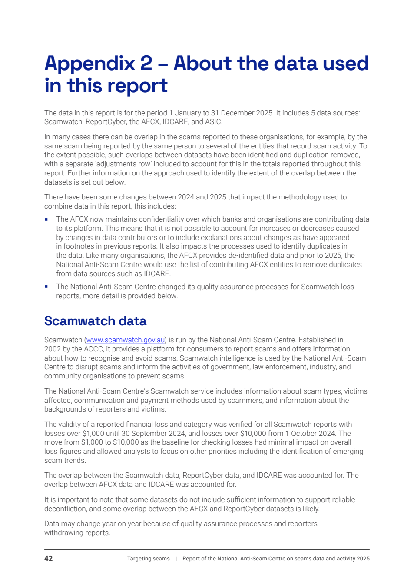

</details>

<!-- page 46 -->
## PDF page 46

Scamwatch data is publicly available at https://www.scamwatch.gov.au/research-and-resources/
scam-statistics.

From 1 January 2026 the National Anti-Scam Centre has implemented a new simplified scam
taxonomy through the Scamwatch report form to improve data comparability. To assist stakeholders
to make Scamwatch comparisons in the future the 2025 data will be mapped to the new taxonomy
and will be available on the website. Data from 2020 to 2025 will also remain available in the old
taxonomy format.

### Australian Signals Directorate – ReportCyber

ReportCyber is a cybercrime reporting platform hosted by the Australian Cyber Security Centre within
the Australian Signals Directorate. It was developed as a national policing initiative with state and
territory police, the AFP and the Australian Criminal Intelligence Commission. Australians can report
a cybercrime to their local law enforcement authorities via www.cyber.gov.au. Some of the reports
made to ReportCyber are scams and the National Anti-Scam Centre has access to these reports.

Only reports in the ReportCyber dataset relating to scams (rather than other types of cybercrime)
were included in this report. Throughout the year, high loss reports in ReportCyber of $1 million and
over were reviewed for accuracy and validity, for example by checking in AUSTRAC’s databases.

Overlap between the ReportCyber and Scamwatch datasets was identified by matching reports with
the same reporter name and reported loss amount. To detect duplicate reports of the same incident
within ReportCyber, reports appearing to relate to the same incident from the same reporter were
flagged as potential duplicates. Any duplicates identified through this process were removed from the
dataset used in this report.

### IDCARE – Identity theft and cyber support service

IDCARE (www.idcare.org) is Australia and New Zealand’s national identity and cyber support service.
It is a registered charity that receives some government funding and is funded by subscribers that
use its services. The public can also contact IDCARE to receive free advice and support. IDCARE
provides support for scam victims as well people who have experienced identify takeover, lost or
stolen credentials, data breaches, hacking or cyber security concerns. The National Anti-Scam
Centre has had automated referral processes with IDCARE since its commencement in July 2023.
This ensures victims who lose money or identity information are referred in real time to IDCARE
for support. Other organisations such as most banks, law enforcement agencies and many other
organisations refer their customers to IDCARE for support.

IDCARE data included in this reported is limited to reports about Australians (i.e. excluding New
Zealand or other international parties) of scam types. Overlap between the IDCARE dataset and other
datasets was addressed by identifying reports to IDCARE referred by any of the National Anti-Scam
Centre, the ReportCyber, ASIC, AFCX members,99 and Police services.100

99 Limited to the following entities: Bendigo and Adelaide bank, ANZ Bank, the Bank of Queensland, Commonwealth Bank,
Latitude Financial Services, Macquarie Bank, the National Australia Bank, Suncorp Bank, Westpac Bank. In 2025 AFCX no
longer discloses the contributing data sources.
100 The Australian Federal Police, New South Wales Police Force, Northern Territory Police Force, Queensland Police Service,
South Australia Police, Tasmania Police, Victoria Police, and Western Australia Police Force.

### Links on this page

- [https://www.scamwatch.gov.au/research-and-resources/scam-statistics](https://www.scamwatch.gov.au/research-and-resources/scam-statistics)
- [http://www.cyber.gov.au](http://www.cyber.gov.au)
- [http://www.idcare.org](http://www.idcare.org)

<details>
<summary>PDF page 46: original layout / charts</summary>

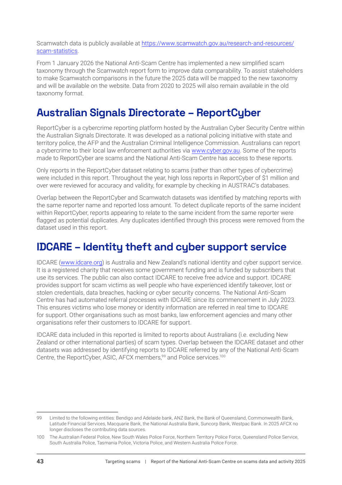

</details>

<!-- page 47 -->
## PDF page 47

### Australian Securities and Investments Commission

### (ASIC)

ASIC (www.asic.gov.au) is Australia’s corporate, markets, financial services and consumer credit
regulator. Since November 2023, ASIC has directed consumers to report scams to Scamwatch. ASIC
and the National Anti-Scam Centre established automated data sharing arrangements in 2024, which
simplifies the process of reporting investment scams from Scamwatch to ASIC.

ASIC receives Reports of Misconduct as well as intelligence from overseas regulators which may
concern investment and other scams. These reports are included in the data contributed by ASIC in
this report and were provided in aggregate format.

### Financial sector data

The AFCX is a not-for-profit company formed by major banks. The AFCX provide a platform where
participating organisations share and gain operational data and insights from each other. The AFCX
data is different from Scamwatch reporting data.

The aggregated AFCX data presented in this report is derived from information contributed by
AFCX members.101 The data reflects information reported by contributing members at the time of
submission. Incremental change to the data is expected as more members report, and variations
may also occur across reporting periods due to changes in AFCX membership.102 The AFCX data
may contain differences, corrections, or overlapping entries. Incidences may have been reported
to multiple AFCX members and reporting nuances reflecting diverse methodologies and timing of
contributions from each member. In some cases, a customer may recover part or all their loss, and
the total reported losses are not adjusted for recoveries.

The AFCX data referred to in this report includes situations where people may have also reported to
Scamwatch, ReportCyber, and/or IDCARE, while some attempt has been made to identify duplicates,
some will remain.

### Comparison with data outcomes in the Targeting

### Scams Report 2024

The methodology used in this report is consistent with that applied in 2024 noting the changes listed
earlier in this appendix. Adjustments this year primarily reflect overlapping reports with IDCARE. The
National Anti-Scam Centre will continue to work explore ways to present data to support consistent
comparisons over time.

101 Although reasonable efforts have been made to collate and compile AFCX member data and present the information
accurately, neither AFCX, or any AFCX member guarantees the accuracy, currency, relevance, completeness or reliability
of the information within this report. All underlying information remains subject to confidentiality. Any conclusions or
summaries about the AFCX data presented in this Report are indicative only and should not be relied upon as sole evidence
for any actions or decisions. To the maximum extent permitted by law, the AFCX and contributing members disclaim liability
for any loss arising from reliance on this data.
102 The AFCX maintains confidentiality over the number of members added or removed during this reporting period or the list of
contributing members.

### Links on this page

- [http://www.asic.gov.au](http://www.asic.gov.au)

<details>
<summary>PDF page 47: original layout / charts</summary>

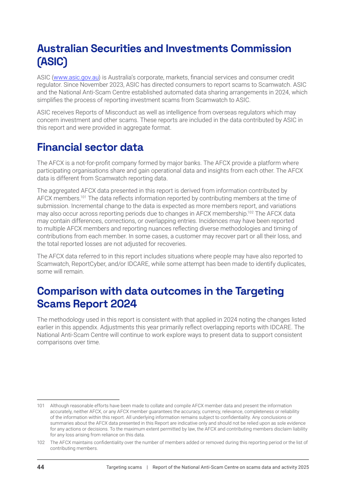

</details>

<!-- page 48 -->
## PDF page 48

### Unreported losses

Not all Australians report scams. Despite the existence of multiple reporting platforms, the extent
and impact of scams is under-reported, and some cohorts are markedly under-represented in official
reporting figures as noted above.

The Australian Bureau of Statistics (ABS) Personal Fraud data shows that in the 2024–25 financial
year (the most recent data available), 2.7% of Australians (596,600) experienced a scam.103 This
was approximately 80,000 less than in the previous year. The fall was driven by a drop in phishing
scams with nearly 42,000 fewer victims. Buying or selling scams continued to be the most common
scam type in Australia experienced by about 300,000 people. An estimated 71.0% of people who
experienced a scam notified (or were notified by) an authority.

This means that almost 30.0% of people who experienced a scam did not report it. It is likely
many of those who did not report incurred a small or no direct financial loss. Consequently, this
under-reporting does not mean actual losses would be 30.0% higher if those people had reported.
The National Anti-Scam Centre acknowledges that in some communities, people may face significant
barriers to reporting and some people may be reluctant to report certain high loss scams, for
example Romance scams due to stigma or shame.

103 Australian Bureau of Statistics (ABS), Personal fraud, 2024–25, ABS website, 2026, accessed 16 March 2026.

### Links on this page

- [https://www.abs.gov.au/statistics/people/crime-and-justice/personal-fraud/2024-25](https://www.abs.gov.au/statistics/people/crime-and-justice/personal-fraud/2024-25)

<details>
<summary>PDF page 48: original layout / charts</summary>

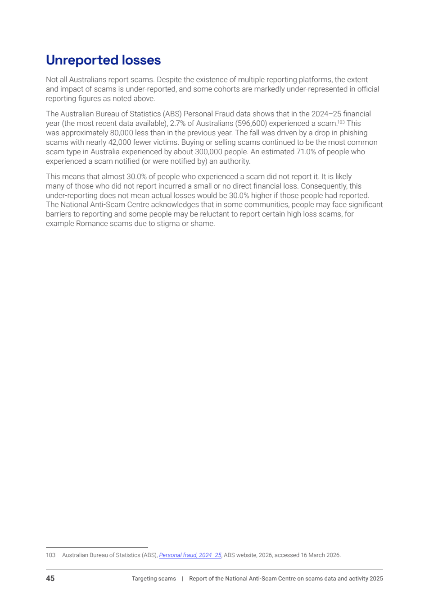

</details>

<!-- page 49 -->
## PDF page 49

<details>
<summary>PDF page 49: original layout / charts</summary>

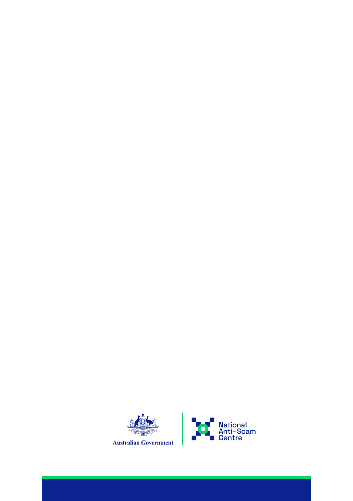

</details>
